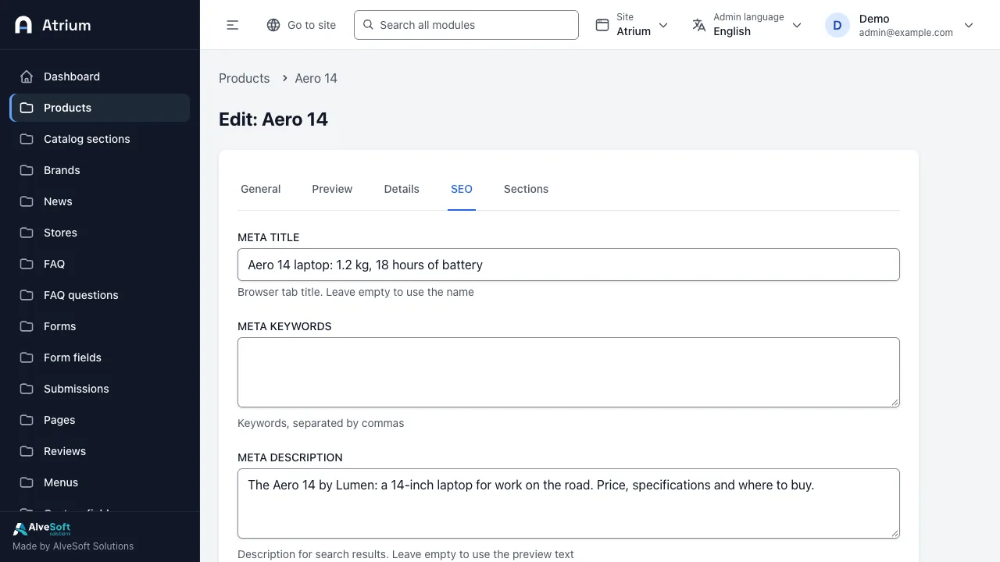

# Atrium

[English](../../README.md) · [Русский](README.ru.md) · [Українська](README.uk.md) · [Беларуская](README.be.md) · **Қазақша** · [Oʻzbekcha](README.uz.md) · [Deutsch](README.de.md) · [Français](README.fr.md) · [Español](README.es.md) · [Português (Brasil)](README.pt-BR.md) · [Italiano](README.it.md) · [Polski](README.pl.md) · [Türkçe](README.tr.md) · [简体中文](README.zh-CN.md) · [日本語](README.ja.md)

[](https://github.com/AlveBy/atrium/actions/workflows/tests.yml)

_Бұл бет ағылшын тілінен машиналық аудармамен жасалған. Түзетулерге қуаныштымыз, толығырақ: [CONTRIBUTING.md](../../CONTRIBUTING.md)._

Laravel 13 негізіндегі кез келген санды көптілді сайтқа арналған бір әкімшілік панелі және дайын сайтты 1С-Битрикстен көшіретін мигратор.

Модуль бір рет сипатталады: модель, оның өрістері мен тізім бағандары. Қалғанын Atrium өзі жасайды: іздеуі мен сұрыптауы бар тізім, қойындылары бар пішін, мәзір пункті, API, ал тақырыппен бірге сайттағы беттер де.


> **Алғашқы релизге дейін.** Atrium жұмыс істейді және тесттермен қамтылған, бірақ 0.1 нұсқасы әлі шыққан жоқ, ал пакеттер Packagist-те әзірге жоқ. Оны осы репозиторийден байқап көруге болады.

## Не істей алады

- **Көп сайт.** Көп сайтқа бір әкімшілік панелі және бір дерекқор. Сайт доменіне немесе ондағы папкаға (`example.com/site2/`) қарай анықталады, әр сайттың өз тілдері бар.
- **Көп тіл.** Әкімшілік панелі 15 тілде сөйлейді, әр әкімші өз тілін таңдайды. Контент тілдері панельде қосылады, модульдің кез келген бағанын аударылатын етуге болады, ал әр тілдің өз мекенжайлары (`/de/…`) мен `hreflang` бар.
- **Өрістің 20 түрі.** Мәтін, сандар, күндер, тізімдер, басқа модульдерге байланыстар, суреттер, галереялар, файлдар, визуалды редактор, карталар, қайталанатын мәндер. Пішін 1С-Битрикстегідей қойындыларға бөлінген.
- **Рөлдер мен құқықтар.** Кім қай модульді көреді және онда не істей алады: қарау, құру, өңдеу, жою.
- **Бағдарламашысыз SEO.** Әр жазбаның тақырыптары мен сипаттамалары, ескі мекенжайлардан қайта бағытталатын оқылатын мекенжайлар, әр сайт үшін `sitemap.xml` және `robots.txt`. Google Tag, Яндекс Метрика және растау кодтары әр сайт үшін панельде бапталады.
- **API.** Тек таңдалған модульдер мен әрекеттерге рұқсаты бар токендер; `/api/v1` өзінде не бар екенін өзі сипаттайды. ЖИ-көмекшілер (Claude, ChatGPT, Cursor) `/mcp` адресіне сол токенмен және дәл соның құқықтарымен қосылады.
- **Кіру коды поштаға.** Екі факторлы кіру әдепкі бойынша қосулы.
- **1С-Битрикстен мигратор.** Инфоблоктар, қасиеттер, бөлімдер, пішіндер, тізімдердің орналасуы, SEO және медиакітапхана Laravel модельдеріне, миграциялар мен деректерге айналады, ал есеп ескі сайтты жаңасымен салыстырады.
- **Сайт тақырыбы.** Кез келген модульді панельдегі пішініне қарай салатын бейтарап сайт. Ашық және қараңғы, түсті кез келген қабылдауда оңай оқылады.
- **Тесттер.** SQLite, MySQL және PostgreSQL-де PHPUnit, Laravel Dusk-та браузерлік тесттер.

| Жазба пішіні | Әкімшіліктен іздеу |
|---|---|
|  |  |

| Мәзірлер | Басқару тақтасы |
|---|---|
|  |  |

| Сайт, ашық тақырып | Сайт, қараңғы тақырып |
|---|---|
|  |  |

## Байқап көру

Docker болса, басқа ештеңе керек емес:

```bash
git clone https://github.com/AlveBy/atrium.git
cd atrium
docker compose up
```

Алғашқы іске қосу бірнеше минутқа созылады. Содан кейін http://localhost:8000/admin ашып, `admin@example.com` ретінде `password` құпиясөзімен кіріңіз (тек өз компьютеріңізде байқап көру үшін). Сайт http://localhost:8000 мекенжайында.

Docker-сіз PHP 8.3 немесе жаңарағы және Composer қажет. Әдепкі дерекқор — SQLite, ал әкімшілік панелі алдын ала жиналған, сондықтан MySQL де, Node да керек емес:

```bash
git clone https://github.com/AlveBy/atrium.git
cd atrium
composer install
cp .env.example .env
php artisan key:generate
php artisan atrium:install --demo
php artisan serve
```

Орнатқыш бірінші әкімшінің атын, поштасын және құпиясөзін сұрайды. Кіру коды поштаға жіберіледі; поштасы жоқ жергілікті компьютерде ол `storage/logs/laravel.log` соңында болады, ал оны `.env` ішіндегі `ATRIUM_2FA_ENABLED=false` жолымен өшіруге болады.

`--demo` шағын дүкен қосады: өрістің барлық түрлері бар тауарлар, брендтер, дүкендер, үш тілдегі жаңалықтар және екінші сайт. Басынан бастау үшін `database/database.sqlite` файлын жойып, қайта орнатыңыз.

## Алғашқы модуль

```bash
php artisan atrium:make-module Article
php artisan migrate
```

Команда модельді, миграцияны және `config/atrium.php` ішіндегі жолды жасайды, ал мәзірде «Articles» пайда болады. Модель өз пішіні мен тізімін сипаттайды:

```php
class Article extends Model implements Administrable
{
    use InteractsWithAdmin, Translatable;

    protected array $translatable = ['name', 'code', 'preview_text', 'detail_text'];

    public static function getAdministrationFields(): array
    {
        return [
            TextField::make('name')->label('Name')->required(),
            SlugField::make('code')->label('Code')->from('name')->unique('articles', 'code'),
            CheckboxField::make('active')->label('Active')->default(true),
            ContentField::make('detail_text')->label('Detail text'),
        ];
    }

    public static function getAdministrationListColumns(): array
    {
        return [
            TextColumn::make('name')->label('Name')->sortable()->searchable(),
            BooleanColumn::make('active')->label('Active'),
        ];
    }
}
```

Модульдің сайтта беттері болуы үшін оны `config/atrium.php` ішіндегі `public_urls` тізіміне қосыңыз:

```php
'public_urls' => [
    App\Models\Article::class => ['prefix' => 'articles'],
],
```

## 1С-Битрикстен көшу

```bash
composer require alveby/atrium-bitrix --dev
php artisan atrium:bitrix:migrate
php artisan atrium:bitrix:parity
```

Битрикс дерекқоры тек оқылады. Қойындылар, өрістер реті және тізім бағандары редакторлар Битриксте баптағандай болып шығады. `atrium:bitrix:sync` ескі сайт әлі жұмыс істеп тұрғанда онда енгізілген түзетулерді қуып жетеді. Қадам бойынша: [packages/bitrix/README.md](../../packages/bitrix/README.md) (ағылшынша).

## Құжаттама

- [Орнату: өз серверіңіз, ISPmanager немесе cPanel хостингі, Docker](../installation.md)
- [Баптау: пошта және кіру коды, файлдар, API-токендер, MCP арқылы ЖИ-көмекшілер](../configuration.md)
- [Мәтіндерге арналған ЖИ-көмекші: тегін және ақылы провайдерлер, сипаттамалар, SEO, alt, аудармалар](../ai.md)
- [Мәзірлер: тақырып пен төменгі бөлік, сілтемелер ағашы, модульді ашатын тармақтар](../menus.md)
- [Іздеу: нәтижелер беті, әкімшілік панельдегі жол, не және қалай ізделеді](../search.md)
- [Өз модуліңіз: өрістер, бағандар, қойындылар, құқықтар, тілдер, тесттер, пакет](../modules.md)
- [Өз өрістеріңіз: кез келген модульге әкімшілік панельден өріс қосу, 100 000 жазбадағы сүзгілер мен фасеттер](../custom-fields.md)
- [Кэш: ондаған қасиеті бар жылдам беттер, Redis, беттер кэші, CDN тақырыптары](../cache.md)
- [1С-Битрикстен көшу, қадам-қадаммен](../bitrix.md)
- [Сақтық көшірмелер: дерекқорлар мен файлдар бірнеше орынға, кесте, тексерулер, қалпына келтіру](../backup.md)
- [Қателер: PHP, кезек және JavaScript қателері сайт дерекқорында, хабарламалар, Sentry және өз драйверлеріңіз](../errors.md)
- [Жылдамдық пен қолжетімділік: сервер уақыттары, келушілердің Web Vitals көрсеткіштері, хабарламалары бар қолжетімділік тексерулері](../monitoring.md)
- [CDN: суреттер, кішірейтілген көшірмелер және WebP/AVIF, кэшті тазалау, S3-ке жүктеу](../cdn.md)

## Пакеттер

| Пакет | Бұл не |
|---|---|
| [`alveby/atrium`](../../packages/admin) | Әкімшілік панелі |
| [`alveby/atrium-theme`](../../packages/theme/README.md) | Сайт тақырыбы |
| [`alveby/atrium-bitrix`](../../packages/bitrix/README.md) | 1С-Битрикстен мигратор |
| [`alveby/atrium-ai`](../../packages/ai/README.md) | Әкімшілік панельдегі мәтіндерге арналған ЖИ-көмекші |
| [`alveby/atrium-custom-fields`](../../packages/custom-fields/README.md) | Кез келген модульге әкімшілік панельден қосылатын өрістер, сүзгілер мен фасеттермен |
| [`alveby/atrium-docs`](../../packages/docs/README.md) | Markdown-тан құжаттама: нұсқалар мен іздеу |
| [`alveby/atrium-backup`](../../packages/backup/README.md) | Дерекқорлар мен файлдардың сақтық көшірмелері, әкімшілік панельден қалпына келтіру |
| [`alveby/atrium-errors`](../../packages/errors/README.md) | Сайт дерекқорындағы қателер есебі, хабарламалар, Sentry |
| [`alveby/atrium-monitoring`](../../packages/monitoring/README.md) | Сервер мен келушілердің жылдамдығы, қолжетімділік пен хабарламалар, сыртқы қызметтерсіз |
| [`alveby/atrium-menus`](../../packages/menus/README.md) | Әкімшілік панельде жиналған мәзірлер |
| [`alveby/atrium-search`](../../packages/search/README.md) | Барлық модульдер бойынша сайттан іздеу |

Пакеттер Packagist-те бар, бірақ 0.1 тегпен белгіленгенге дейін тек әзірлеу нұсқасы ретінде — сондықтан оны көрсетіңіз:

```bash
composer require alveby/atrium:dev-main
php artisan atrium:install
```

## Талаптар

- PHP 8.3 немесе жаңарағы
- Laravel 13
- SQLite, MySQL 8 немесе PostgreSQL

## Тілдер

Әкімшілік панелі ағылшын, орыс, украин, беларус, қазақ, өзбек, неміс, француз, испан, португал (Бразилия), итальян, поляк, түрік, қытай (жеңілдетілген) және жапон тілдерінде сөйлейді. Ағылшын және орыс тілдері қолмен жазылған, қалғандары, осы README-дің басқа тілдердегі нұсқалары сияқты, машиналық аудармадан басталды. Ана тілінде сөйлейтіндердің түзетулері — жобаға алғашқы үлес қосудың ең жақсы жолдарының бірі, толығырақ: [CONTRIBUTING.md](../../CONTRIBUTING.md) (ағылшынша).

## Бәрі қалай басталды

Atrium 2025 жылдың желтоқсанында [AlveSoft](https://alve.by) компаниясында тапсырыс берушінің [arkaim.by](https://arkaim.by) сайтындағы 1С-Битриксті ауыстыратын өзіміздің әкімшілік панеліміз ретінде пайда болды. Біз редакторға Битрикстегідей таныс, бірақ қарапайым Laravel негізіндегі әкімшілік панелін және мазмұнды жоғалтпай көшіретін мигратор қалаған едік. 2026 жылдың жазынан бастап панель сол сайтта жұмыс істеп тұр: редакторлар онда күн сайын мазмұнмен жұмыс істейді, ал мигратор барлық каталогты, беттер мен пішіндерді көшірді.

2026 жылдың қарашасында оны бәріне беруді шештік. Сол бір сайтқа қатысты барлық нәрсені алып тастап, қалғанын MIT лицензиясымен жарияладық, сонда кез келген адам оны тегін пайдалана, өзгерте алады және өз сайттарын соның негізінде жасай алады.

## Әрі қарай

[Даму жоспары](../../ROADMAP.md) (ағылшынша): бір командамен орнатылатын модульдер, дайын сайттар, WordPress пен Drupal-дан көшу, интернет-дүкен, 1С және Битрикс24.

## Үлес қосу

[CONTRIBUTING.md](../../CONTRIBUTING.md) файлында жобаны қалай көтеру, тесттерді қалай іске қосу және қалай аудару керектігі жазылған. Осалдықтар туралы [SECURITY.md](../../SECURITY.md) файлында сипатталғандай хабарлаңыз.

## Лицензия

MIT, [LICENSE](../../LICENSE) қараңыз.

Atrium сізге көмектессе, сайттың төменгі колонтитулындағы «Atrium негізінде жасалған» сілтемесін қалдыруыңызды сұраймыз. Бұл лицензия шарты емес, өтініш қана: MIT тек код көшірмелерінде авторлық құқық туралы ескертуді сақтауды талап етеді.
