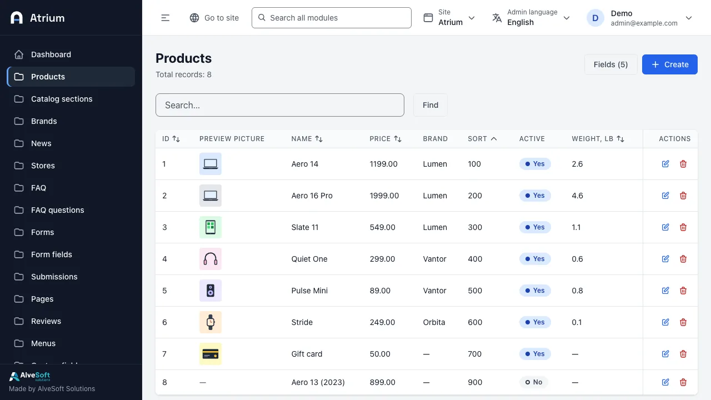
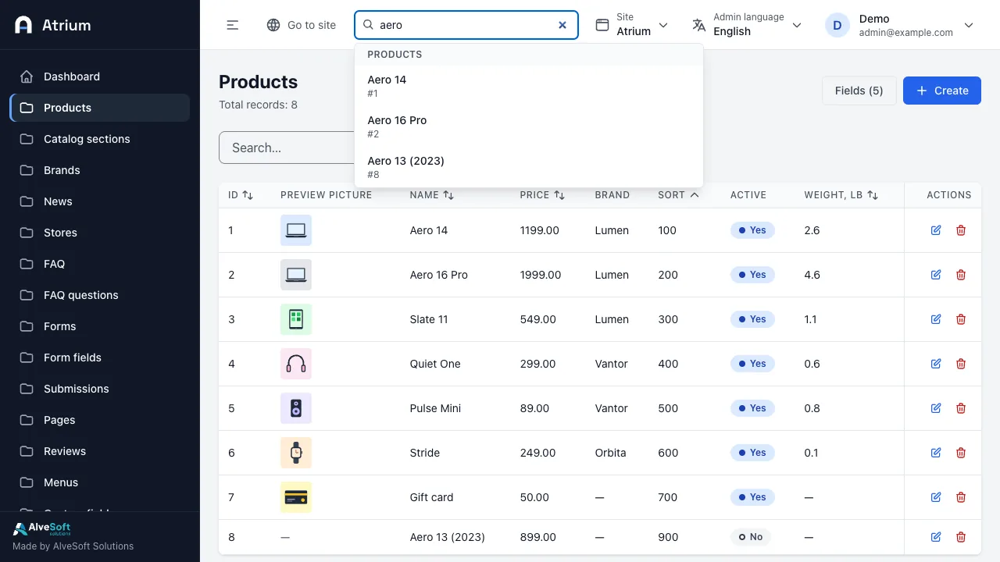
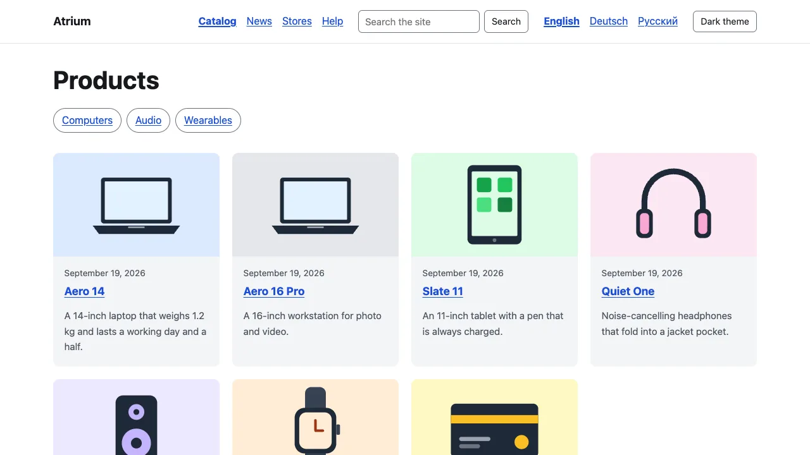

# Atrium

[English](../../README.md) · [Русский](README.ru.md) · [Українська](README.uk.md) · [Беларуская](README.be.md) · [Қазақша](README.kk.md) · [Oʻzbekcha](README.uz.md) · [Deutsch](README.de.md) · [Français](README.fr.md) · [Español](README.es.md) · [Português (Brasil)](README.pt-BR.md) · [Italiano](README.it.md) · **Polski** · [Türkçe](README.tr.md) · [简体中文](README.zh-CN.md) · [日本語](README.ja.md)

[](https://github.com/AlveBy/atrium/actions/workflows/tests.yml) [](../testing.md)

_Ta strona została przetłumaczona maszynowo z angielskiego. Poprawki są mile widziane, zobacz [CONTRIBUTING.md](../../CONTRIBUTING.md)._

Jeden panel administracyjny dla dowolnej liczby wielojęzycznych witryn, zbudowany na Laravel 13, z migratorem, który przenosi istniejącą witrynę z 1C-Bitrix.

Moduł opisujesz raz: jako model z jego polami i kolumnami listy. Atrium daje mu listę z wyszukiwaniem i sortowaniem, formularz z kartami, pozycję w menu, API, a razem z motywem także strony publiczne.



> **Przed pierwszym wydaniem.** Atrium działa i jest pokryty testami, ale wersja 0.1 jeszcze się nie ukazała, a pakietów nie ma na Packagist. Wypróbuj go z tego repozytorium.

## Co potrafi

- **Wiele witryn.** Jeden panel i jedna baza danych dla wielu witryn; każda jest rozpoznawana po domenie lub folderze w niej (`example.com/site2/`) i ma własne języki.
- **Wielojęzyczność.** Panel mówi w 15 językach, a każdy administrator wybiera swój. Języki treści dodaje się w panelu, każdą kolumnę modułu można oznaczyć jako tłumaczalną, a każdy język dostaje własne adresy (`/de/…`) i `hreflang`.
- **20 typów pól.** Tekst, liczby, daty, listy, powiązania z innymi modułami, obrazy, galerie, pliki, edytor wizualny, mapy, wartości wielokrotne. Formularze mają karty, jak w 1C-Bitrix.
- **Role i uprawnienia.** Kto widzi który moduł i co może w nim robić: podgląd, tworzenie, edycja, usuwanie.
- **SEO bez programisty.** Tytuły i opisy dla każdego rekordu, czytelne adresy z przekierowaniami ze starych, `sitemap.xml` i `robots.txt` dla każdej witryny. Google Tag, Yandex Metrica i kody weryfikacyjne ustawia się w panelu osobno dla każdej witryny.
- **API.** Tokeny ograniczone do wybranych modułów i akcji; `/api/v1` sam opisuje, co zawiera. Asystenci AI (Claude, ChatGPT, Cursor) łączą się z `/mcp` tym samym tokenem i dokładnie z jego uprawnieniami.
- **Kod logowania e-mailem.** Logowanie dwuetapowe jest domyślnie włączone.
- **Migrator z 1C-Bitrix.** Infobloki, właściwości, sekcje, formularze, układy list, SEO i biblioteka mediów stają się modelami Laravel, migracjami i danymi, a raport porównuje starą witrynę z nową.
- **Motyw publiczny.** Neutralna witryna, która rysuje każdy moduł na podstawie jego formularza w panelu, w wersji jasnej i ciemnej, czytelna przy każdym rodzaju widzenia barw.
- **Przetestowany.** PHPUnit na SQLite, MySQL i PostgreSQL, testy w przeglądarce z Laravel Dusk.

| Formularz rekordu | Wyszukiwanie w panelu |
|---|---|
|  |  |

| Menu | Pulpit |
|---|---|
|  |  |

| Strona, jasny motyw | Strona, ciemny motyw |
|---|---|
|  |  |

## Jakość

- Ponad 6500 testów PHPUnit i ponad 80 testów przeglądarkowych w Laravel Dusk uruchamia się przy każdym pull requeście.
- Na SQLite, MySQL i PostgreSQL, pod PHP 8.3 i 8.4.
- Każdy pakiet ma pokryte testami 100% linii, a CI odrzuca zmianę, po której choć jedna linia zostaje bez testu.
- Zmieniony kod musi mieć 100% w testach mutacyjnych: Infection psuje każdą zmienioną linię i przy każdym zepsuciu musi paść jakiś test.
- Nic nie jest wyłączone z tych kontroli: żadnych adnotacji pomijania, żadnych wyłączonych mutatorów.
- Każdy push jest sprawdzany pod kątem zależności ze znanymi lukami i sekretów w historii git.

[Jak działają testy i kontrole](../testing.md).

## Wypróbuj

Z Dockerem nic więcej nie jest potrzebne:

```bash
git clone -b stable https://github.com/AlveBy/atrium.git
cd atrium
docker compose up
```

Pierwsze uruchomienie trwa kilka minut. Potem otwórz http://localhost:8000/admin i zaloguj się jako `admin@example.com` hasłem `password` (tylko do prób na własnym komputerze). Witryna jest pod adresem http://localhost:8000.

Bez Dockera potrzebujesz PHP 8.3 lub nowszego oraz Composera. Domyślną bazą danych jest SQLite, a panel jest już zbudowany, więc nie potrzeba ani MySQL, ani Node:

```bash
git clone -b stable https://github.com/AlveBy/atrium.git
cd atrium
composer install
cp .env.example .env
php artisan key:generate
php artisan atrium:install --demo
php artisan serve
```

Instalator zapyta o imię, adres e-mail i hasło pierwszego administratora. Kod logowania przychodzi e-mailem; na lokalnym komputerze bez poczty znajdziesz go na końcu `storage/logs/laravel.log`, możesz też go wyłączyć, ustawiając `ATRIUM_2FA_ENABLED=false` w `.env`.

`--demo` dodaje mały sklep internetowy: produkty ze wszystkimi typami pól, marki, sklepy, aktualności w trzech językach i drugą witrynę. Aby zacząć od nowa, usuń `database/database.sqlite` i zainstaluj ponownie.

## Twój pierwszy moduł

```bash
php artisan atrium:make-module Article
php artisan migrate
```

To polecenie tworzy model, migrację i wiersz w `config/atrium.php`, a w menu pojawia się „Articles”. Model opisuje swój formularz i listę:

```php
class Article extends Model implements Administrable
{
    use InteractsWithAdmin, Translatable;

    protected array $translatable = ['name', 'code', 'preview_text', 'detail_text'];

    public static function getAdministrationFields(): array
    {
        return [
            TextField::make('name')->label(__('atrium::fields.standard.name'))->required(),
            SlugField::make('code')->label(__('atrium::fields.standard.code'))->from('name')->unique('articles', 'code'),
            CheckboxField::make('active')->label(__('atrium::fields.standard.active'))->default(true),
            ContentField::make('detail_text')->label(__('atrium::fields.standard.detail_text')),
        ];
    }

    public static function getAdministrationListColumns(): array
    {
        return [
            TextColumn::make('name')->label(__('atrium::fields.standard.name'))->sortable()->searchable(),
            BooleanColumn::make('active')->label(__('atrium::fields.standard.active')),
        ];
    }
}
```

Aby moduł miał strony w witrynie, dodaj go do `public_urls` w `config/atrium.php`:

```php
'public_urls' => [
    App\Models\Article::class => ['prefix' => 'articles'],
],
```

## Przeprowadzka z 1C-Bitrix

```bash
composer require alveby/atrium-bitrix --dev
php artisan atrium:bitrix:migrate
php artisan atrium:bitrix:parity
```

Baza danych Bitrixa jest tylko odczytywana. Karty, kolejność pól i kolumny list wychodzą takie, jakie ustawili sobie redaktorzy w Bitrixie. `atrium:bitrix:sync` nadrabia zmiany wprowadzane na starej witrynie, dopóki ta jeszcze działa. Krok po kroku: [packages/bitrix/README.md](../../packages/bitrix/README.md) (po angielsku).

## Dokumentacja

- [Instalacja: własny serwer, hosting z ISPmanager lub cPanel, Docker](../installation.md)
- [Publiczne demo: Docker, reset co godzinę, co może gość, gdzie je hostować](../demo.md)
- [Konfiguracja: poczta i kod logowania, pliki, tokeny API, asystenci AI przez MCP](../configuration.md)
- [Pomoc AI w pisaniu: darmowi i płatni dostawcy, opisy, SEO, teksty alt, tłumaczenia](../ai.md)
- [SEO: tytuły, hreflang, mapy witryny, schema.org, przekierowania, kontrola SEO](../seo.md)
- [Menu: nagłówek i stopka, drzewo linków, pozycje rozwijające moduł](../menus.md)
- [Formularze: kreator w kolumnach, wysyłanie bez przeładowania strony, w oknie, własny znacznik i fetch](../forms.md)
- [Osadzenia: formularz lub blok w tekście i jak moduł rejestruje własny typ](../embeds.md)
- [Bloki: telefon lub baner napisany raz i pokazywany w szablonach i tekstach](../blocks.md)
- [Wyszukiwanie: strona wyników, pole w panelu, co i jak jest wyszukiwane](../search.md)
- [Własny moduł: pola, kolumny, zakładki, uprawnienia, języki, testy, pakiet](../modules.md)
- [Rozszerzenia: projekt platformy — kreator bez kodu, formuły, wtyczki, zewnętrzne aplikacje, plan](../extensions.md)
- [Własne pola: dodawanie pól do dowolnego modułu z panelu, filtry i fasety na 100 000 rekordów](../custom-fields.md)
- [Import i eksport: CSV i Excel dla każdego modułu, kolumny, sprawdzenie przed zapisem, konsola i harmonogram](../import-export.md)
- [Cache: szybkie strony z dziesiątkami właściwości, Redis, cache stron, nagłówki dla CDN](../cache.md)
- [Przeprowadzka z 1C-Bitrix krok po kroku](../bitrix.md)
- [Przeprowadzka z WordPressa: połączenie z bazą, przeniesienie, kontrola, mapa 301](../wordpress.md)
- [Kopie zapasowe: bazy danych i pliki w kilku miejscach, harmonogram, kontrole, przywracanie](../backup.md)
- [Błędy: błędy PHP, kolejek i JavaScriptu w bazie strony, powiadomienia, Sentry i własne sterowniki](../errors.md)
- [Szybkość i dostępność: czasy serwera, Web Vitals odwiedzających, kontrole dostępności z powiadomieniami](../monitoring.md)
- [Integracje: baza konektorów 1C i Bitrix24, kolejka z ponowieniami, dziennik wymiany, powiadomienia dla administratorów](../integrations.md)
- [Bitrix24: zgłoszenia z formularzy stają się leadami lub transakcjami, widżet czatu na stronie, jeden wklejony webhook](../bitrix24.md)
- [1C: katalog z 1C:Enterprise przez standardową wymianę CommerceML, ekran wymiany](../1c.md)
- [CDN: obrazy, pomniejszone kopie i WebP/AVIF, czyszczenie pamięci podręcznej, przesyłanie do S3](../cdn.md)
- [Logowanie dwuskładnikowe: aplikacje uwierzytelniające, klucze dostępu, kody, dziennik logowań](../two-factor.md)
- [Logowanie przez serwisy społecznościowe: dostawcy, rejestracja aplikacji, adresy przekierowań](../social-login.md)

## Pakiety

| Pakiet | Co to jest |
|---|---|
| [`alveby/atrium`](../../packages/admin) | Panel administracyjny |
| [`alveby/atrium-theme`](../../packages/theme/README.md) | Motyw publiczny |
| [`alveby/atrium-bitrix`](../../packages/bitrix/README.md) | Migrator z 1C-Bitrix |
| [`alveby/atrium-ai`](../../packages/ai/README.md) | Pomoc AI w pisaniu tekstów w panelu |
| [`alveby/atrium-custom-fields`](../../packages/custom-fields/README.md) | Pola dodawane do dowolnego modułu z panelu, z filtrami i fasetami |
| [`alveby/atrium-seo`](../../packages/seo/README.md) | Szablony meta, hreflang, mapy witryny, schema.org, przekierowania i kontrola SEO |
| [`alveby/atrium-docs`](../../packages/docs/README.md) | Dokumentacja z Markdown, z wersjami i wyszukiwaniem |
| [`alveby/atrium-backup`](../../packages/backup/README.md) | Kopie zapasowe baz danych i plików, przywracanie z panelu |
| [`alveby/atrium-errors`](../../packages/errors/README.md) | Rejestr błędów w bazie strony, powiadomienia, Sentry |
| [`alveby/atrium-monitoring`](../../packages/monitoring/README.md) | Szybkość serwera i odwiedzających, dostępność i powiadomienia, bez zewnętrznych usług |
| [`alveby/atrium-integrations`](../../packages/integrations/README.md) | Baza konektorów: kolejka z ponowieniami, dziennik wymiany, powiadomienie o awarii |
| [`alveby/atrium-bitrix24`](../../packages/bitrix24/README.md) | Zgłoszenia z formularzy do Bitrix24 jako leady lub transakcje, widżet czatu |
| [`alveby/atrium-1c`](../../packages/onec/README.md) | Produkty, ceny i stany z 1C przez CommerceML |
| [`alveby/atrium-news`](../../packages/news/README.md) | Aktualności |
| [`alveby/atrium-pages`](../../packages/pages/README.md) | Strony statyczne, z importem stron z 1C-Bitrix |
| [`alveby/atrium-catalog`](../../packages/catalog/README.md) | Katalog produktów z zagnieżdżonymi działami |
| [`alveby/atrium-brands`](../../packages/brands/README.md) | Marki z logo |
| [`alveby/atrium-stores`](../../packages/stores/README.md) | Sklepy i biura na mapie |
| [`alveby/atrium-team`](../../packages/team/README.md) | Osoby, działy i kontakty |
| [`alveby/atrium-faq`](../../packages/faq/README.md) | Pytania i odpowiedzi |
| [`alveby/atrium-forms`](../../packages/forms/README.md) | Kreator formularzy i zgłoszenia |
| [`alveby/atrium-blocks`](../../packages/blocks/README.md) | Bloki wielokrotnego użytku: telefon lub baner napisany raz i pokazywany gdziekolwiek |
| [`alveby/atrium-reviews`](../../packages/reviews/README.md) | Opinie i oceny z moderacją |
| [`alveby/atrium-2fa`](../../packages/two-factor/README.md) | Logowanie dwuskładnikowe i bez hasła |
| [`alveby/atrium-social-login`](../../packages/social-login/README.md) | Logowanie przez Google, Microsoft, Apple, GitHub, Telegram i inne |
| [`alveby/atrium-solutions`](../../packages/solutions/README.md) | Gotowe strony instalowane jednym poleceniem |
| [`alveby/atrium-menus`](../../packages/menus/README.md) | Menu budowane w panelu |
| [`alveby/atrium-search`](../../packages/search/README.md) | Wyszukiwanie w całej witrynie, we wszystkich modułach |
| [`alveby/atrium-wordpress`](../../packages/wordpress/README.md) | Importer WordPressa: wpisy, strony, własne typy wpisów, SEO i tłumaczenia, z kontrolą i mapą 301 |

Pakiety są na Packagist, ale dopóki 0.1 nie ma tagu, tylko jako wersja rozwojowa, więc trzeba ją wskazać:

```bash
composer require alveby/atrium:^0.2
php artisan atrium:install
```

## Wymagania

- PHP 8.3 lub nowszy
- Laravel 13
- SQLite, MySQL 8 lub PostgreSQL

## Języki

Panel administracyjny mówi po angielsku, rosyjsku, ukraińsku, białorusku, kazachsku, uzbecku, niemiecku, francusku, hiszpańsku, portugalsku (Brazylia), włosku, polsku, turecku, chińsku (w wersji uproszczonej) i japońsku. Angielski i rosyjski zostały napisane ręcznie; pozostałe zaczynały jako tłumaczenie maszynowe, podobnie jak ten README. Poprawki od rodzimych użytkowników języka to jeden z najlepszych pierwszych wkładów w projekt: zobacz [CONTRIBUTING.md](../../CONTRIBUTING.md) (po angielsku).

## Jak to się zaczęło

Atrium powstał w grudniu 2025 roku w [AlveSoft](https://alve.by) jako nasz własny panel administracyjny, który miał zastąpić 1C-Bitrix w witrynie klienta, [arkaim.by](https://arkaim.by). Chcieliśmy panelu tak znajomego dla redaktorów jak Bitrix, ale opartego na zwykłym Laravelu, oraz migratora, który przeniesie treści bez strat. Od lata 2026 roku panel działa produkcyjnie na tej witrynie: redaktorzy pracują w nim codziennie, a migrator przeniósł cały katalog, strony i formularze.

W listopadzie 2026 roku postanowiliśmy oddać go wszystkim. Usunęliśmy wszystko, co należało do tej jednej witryny, a resztę opublikowaliśmy na licencji MIT, aby każdy mógł z niego korzystać, zmieniać go i budować na nim swoje witryny za darmo.

## Co dalej

[Plan rozwoju](../../ROADMAP.md) (po angielsku): moduły instalowane jednym poleceniem, gotowe witryny, importery z WordPressa i Drupala, sklep internetowy, 1C i Bitrix24.

## Współpraca

[CONTRIBUTING.md](../../CONTRIBUTING.md) wyjaśnia, jak uruchomić projekt, przeprowadzić testy i tłumaczyć. Problemy z bezpieczeństwem zgłaszaj zgodnie z opisem w [SECURITY.md](../../SECURITY.md).

## Licencja

MIT, zobacz [LICENSE](../../LICENSE).

Jeśli Atrium Ci pomógł, zostaw proszę link „Zbudowane na Atrium” w stopce swojej strony. To prośba, a nie warunek licencji: MIT wymaga jedynie zachowania informacji o prawach autorskich w kopiach kodu.
