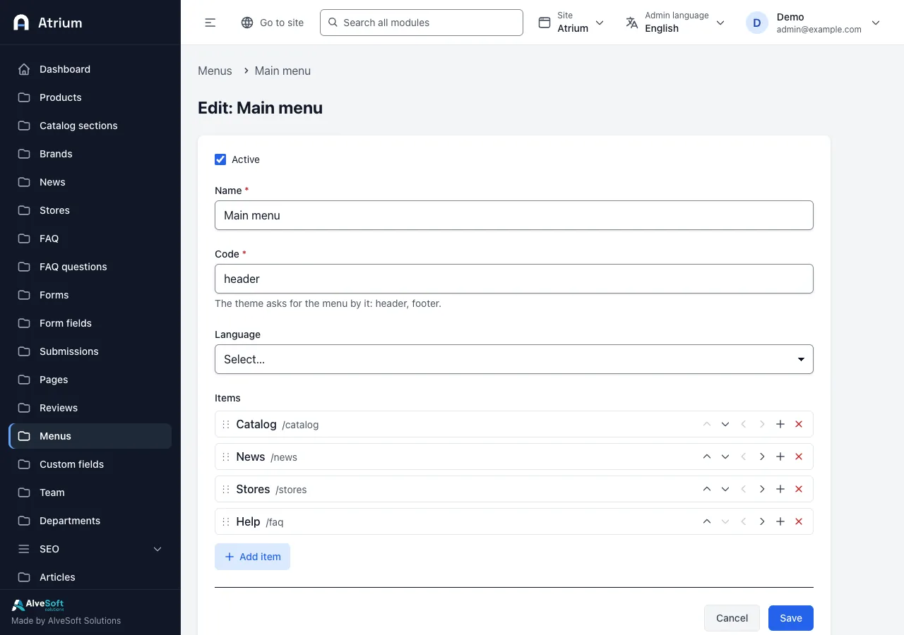
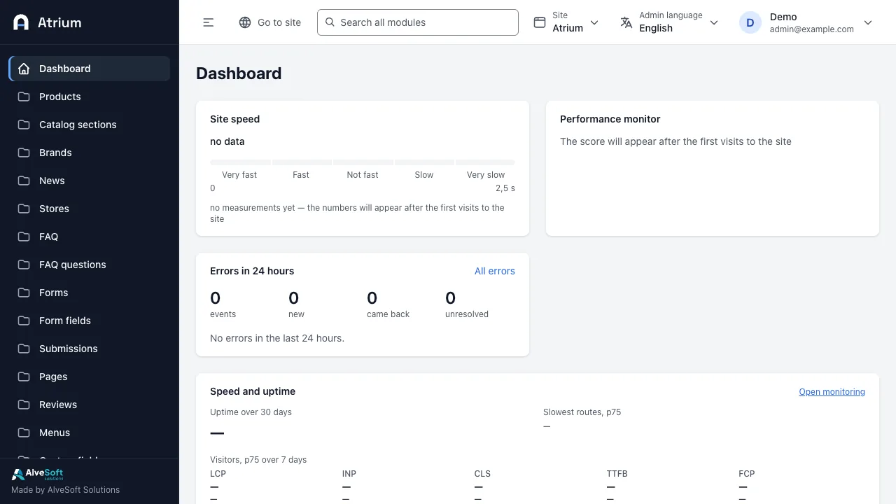

# Atrium

[English](../../README.md) · [Русский](README.ru.md) · [Українська](README.uk.md) · [Беларуская](README.be.md) · [Қазақша](README.kk.md) · [Oʻzbekcha](README.uz.md) · [Deutsch](README.de.md) · [Français](README.fr.md) · [Español](README.es.md) · [Português (Brasil)](README.pt-BR.md) · [Italiano](README.it.md) · [Polski](README.pl.md) · **Türkçe** · [简体中文](README.zh-CN.md) · [日本語](README.ja.md)

[](https://github.com/AlveBy/atrium/actions/workflows/tests.yml) [](../testing.md)

_Bu sayfa İngilizceden makine çevirisiyle hazırlandı. Düzeltmelere açığız, bkz. [CONTRIBUTING.md](../../CONTRIBUTING.md)._

Laravel 13 üzerine kurulu, istediğiniz sayıda çok dilli site için tek bir yönetim paneli ve mevcut bir 1C-Bitrix sitesini taşıyan bir geçiş aracı.

Bir modülü yalnızca bir kez, alanları ve liste sütunlarıyla birlikte bir model olarak tanımlarsınız. Atrium ona arama ve sıralama içeren bir liste, sekmeli bir form, bir menü öğesi, bir API ve temayla birlikte herkese açık sayfalar sağlar.


> **İlk sürümden önce.** Atrium çalışıyor ve testlerle kapsanıyor, ancak 0.1 sürümü henüz çıkmadı ve paketler Packagist'te yok. Bu depodan deneyebilirsiniz.

## Neler yapar

- **Çoklu site.** Birçok site için tek panel ve tek veritabanı; her site alan adına veya onun üzerindeki bir klasöre (`example.com/site2/`) göre seçilir ve kendi dillerine sahiptir.
- **Çok dilli.** Panel 15 dil konuşur ve her yönetici kendi dilini seçer. İçerik dilleri panelden eklenir, bir modülün herhangi bir sütunu çevrilebilir yapılabilir ve her dil kendi adreslerini (`/de/…`) ve `hreflang` etiketlerini alır.
- **20 alan türü.** Metin, sayılar, tarihler, listeler, diğer modüllere bağlantılar, görseller, galeriler, dosyalar, görsel editör, haritalar, tekrarlanabilir değerler. Formlarda, 1C-Bitrix'te olduğu gibi sekmeler bulunur.
- **Roller ve izinler.** Kimin hangi modülü göreceği ve orada ne yapabileceği: görüntüleme, oluşturma, düzenleme, silme.
- **Kod yazmadan SEO.** Her kayıt için başlık ve açıklama, eski adreslerden yönlendirmeli okunabilir adresler, her site için `sitemap.xml` ve `robots.txt`. Google Tag, Yandex Metrica ve doğrulama kodları panelde her site için ayrı ayarlanır.
- **API.** Seçilen modüller ve işlemlerle sınırlı tokenlar; `/api/v1` kendini kendisi tanımlar. Yapay zekâ asistanları (Claude, ChatGPT, Cursor) aynı token ile ve tam olarak onun yetkileriyle `/mcp` adresine bağlanır.
- **E-postayla giriş kodu.** İki adımlı giriş varsayılan olarak açıktır.
- **1C-Bitrix geçiş aracı.** Bilgi blokları, özellikler, bölümler, formlar, liste düzenleri, SEO ve medya kütüphanesi Laravel modellerine, migration'lara ve verilere dönüşür; bir rapor da eski siteyi yenisiyle karşılaştırır.
- **Herkese açık tema.** Her modülü paneldeki formuna göre çizen sade bir site; açık ve koyu modu vardır ve her türlü renk görüşüyle okunabilir.
- **Test edilmiş.** SQLite, MySQL ve PostgreSQL üzerinde PHPUnit, Laravel Dusk ile tarayıcı testleri.

| Bir kaydın formu | Yönetim panelinde arama |
|---|---|
|  |  |

| Menüler | Gösterge paneli |
|---|---|
|  |  |

| Site, açık tema | Site, koyu tema |
|---|---|
|  |  |

## Kalite

- Her pull request'te 6.500'den fazla PHPUnit testi ve Laravel Dusk ile 80'den fazla tarayıcı testi çalışır.
- SQLite, MySQL ve PostgreSQL üzerinde, PHP 8.3 ve 8.4 altında.
- Her paketin satırlarının %100'ü testlerle kaplıdır ve CI bir satırı testsiz bırakan değişikliği kabul etmez.
- Değişen kodun mutasyon puanı %100 olmalıdır: Infection değişen her satırı bozar ve her bozmada bir test başarısız olmalıdır.
- Bu kontrollerden hiçbir şey hariç tutulmaz: yok sayma notu da, kapatılmış mutatör de yoktur.
- Her push, bilinen açıkları olan bağımlılıklar ve git geçmişindeki gizli bilgiler için taranır.

[Testler ve kontroller nasıl çalışır](../testing.md).

## Deneyin

Docker varsa başka hiçbir şeye gerek yok:

```bash
git clone https://github.com/AlveBy/atrium.git
cd atrium
docker compose up
```

İlk başlatma birkaç dakika sürer. Ardından http://localhost:8000/admin adresini açın ve `password` parolasıyla `admin@example.com` olarak giriş yapın (yalnızca yerel denemeler için). Site http://localhost:8000 adresindedir.

Docker olmadan PHP 8.3 veya daha yenisi ve Composer gerekir. Veritabanı varsayılan olarak SQLite'tır ve panel önceden derlenmiş olarak gelir; bu yüzden ne MySQL ne de Node gerekir:

```bash
git clone https://github.com/AlveBy/atrium.git
cd atrium
composer install
cp .env.example .env
php artisan key:generate
php artisan atrium:install --demo
php artisan serve
```

Kurulum aracı ilk yöneticinin adını, e-posta adresini ve parolasını sorar. Giriş kodu e-postayla gönderilir; e-posta ayarlanmamış yerel bir makinede kod `storage/logs/laravel.log` dosyasının sonundadır. Dilerseniz `.env` dosyasında `ATRIUM_2FA_ENABLED=false` ile kapatabilirsiniz.

`--demo` küçük bir online mağaza ekler: her alan türünü kullanan ürünler, markalar, mağazalar, üç dilde haberler ve ikinci bir site. Baştan başlamak için `database/database.sqlite` dosyasını silin ve yeniden kurun.

## İlk modülünüz

```bash
php artisan atrium:make-module Article
php artisan migrate
```

Bu komut bir model, bir migration ve `config/atrium.php` içinde bir satır oluşturur; menüde de “Articles” belirir. Model kendi formunu ve listesini tanımlar:

```php
class Article extends Model implements Administrable
{
    use InteractsWithAdmin, Translatable;

    protected array $translatable = ['name', 'code', 'preview_text', 'detail_text'];

    public static function getAdministrationFields(): array
    {
        return [
            TextField::make('name')->label(__('atrium::fields.standard.name'))->required(),
            SlugField::make('code')->label(__('atrium::fields.standard.code'))->from('name')->unique('articles', 'code'),
            CheckboxField::make('active')->label(__('atrium::fields.standard.active'))->default(true),
            ContentField::make('detail_text')->label(__('atrium::fields.standard.detail_text')),
        ];
    }

    public static function getAdministrationListColumns(): array
    {
        return [
            TextColumn::make('name')->label(__('atrium::fields.standard.name'))->sortable()->searchable(),
            BooleanColumn::make('active')->label(__('atrium::fields.standard.active')),
        ];
    }
}
```

Modülün sitede sayfaları olması için onu `config/atrium.php` içindeki `public_urls` bölümüne ekleyin:

```php
'public_urls' => [
    App\Models\Article::class => ['prefix' => 'articles'],
],
```

## 1C-Bitrix'ten geçiş

```bash
composer require alveby/atrium-bitrix --dev
php artisan atrium:bitrix:migrate
php artisan atrium:bitrix:parity
```

Bitrix veritabanından yalnızca okuma yapılır. Sekmeler, alan sırası ve liste sütunları, editörlerin Bitrix'te ayarladığı şekliyle aktarılır. `atrium:bitrix:sync`, eski site hâlâ yayındayken orada yapılan düzenlemeleri sonradan aktarır. Adım adım anlatım: [packages/bitrix/README.md](../../packages/bitrix/README.md) (İngilizce).

## Belgeler

- [Kurulum: kendi sunucunuz, ISPmanager veya cPanel barındırma, Docker](../installation.md)
- [Herkese açık demo: Docker, her saat sıfırlama, ziyaretçinin neler yapabileceği, nerede barındırılacağı](../demo.md)
- [Yapılandırma: e-posta ve giriş kodu, dosyalar, API tokenları, MCP ile yapay zekâ asistanları](../configuration.md)
- [Yapay zekâ yazım yardımı: ücretsiz ve ücretli sağlayıcılar, açıklamalar, SEO, alt metinleri, çeviriler](../ai.md)
- [SEO: başlıklar, hreflang, site haritaları, schema.org, yönlendirmeler, SEO denetimi](../seo.md)
- [Menüler: üst ve alt bilgi, bağlantı ağacı, bir modülü açan öğeler](../menus.md)
- [Formlar: sütunlu bir oluşturucu, sayfayı yenilemeden gönderme, pencerede, kendi işaretlemeniz ve fetch](../forms.md)
- [Arama: sonuç sayfası, yönetim panelindeki kutu, neyin nasıl arandığı](../search.md)
- [Kendi modülünüz: alanlar, sütunlar, sekmeler, yetkiler, diller, testler, paket](../modules.md)
- [Özel alanlar: yönetim panelinden her modüle alan ekleme, 100 000 kayıtta filtreler ve faset sayıları](../custom-fields.md)
- [İçe ve dışa aktarma: her modül için CSV ve Excel, sütunlar, yazmadan önce kontrol, konsol ve zamanlama](../import-export.md)
- [Önbellek: onlarca özellikli hızlı sayfalar, Redis, sayfa önbelleği, CDN başlıkları](../cache.md)
- [1C-Bitrix’ten adım adım taşınma](../bitrix.md)
- [WordPress’ten taşınma: veritabanını bağlama, taşıma, denetleme, 301 haritası](../wordpress.md)
- [Yedekler: veritabanları ve dosyalar birden çok yere, zamanlama, sağlık kontrolleri, geri yükleme](../backup.md)
- [Hatalar: PHP, kuyruk ve JavaScript hataları sitenin veritabanında, uyarılar, Sentry ve kendi sürücüleriniz](../errors.md)
- [Hız ve erişilebilirlik: sunucu süreleri, ziyaretçilerin Web Vitals değerleri, uyarılı erişilebilirlik kontrolleri](../monitoring.md)
- [CDN: görseller, küçültülmüş kopyalar ve WebP/AVIF, önbellek temizleme, S3'e yükleme](../cdn.md)
- [İki adımlı giriş: doğrulayıcı uygulamalar, geçiş anahtarları, kodlar, giriş günlüğü](../two-factor.md)
- [Sosyal giriş: sağlayıcılar, uygulama kaydı, yönlendirme adresleri](../social-login.md)

## Paketler

| Paket | Nedir |
|---|---|
| [`alveby/atrium`](../../packages/admin) | Yönetim paneli |
| [`alveby/atrium-theme`](../../packages/theme/README.md) | Herkese açık tema |
| [`alveby/atrium-bitrix`](../../packages/bitrix/README.md) | 1C-Bitrix geçiş aracı |
| [`alveby/atrium-ai`](../../packages/ai/README.md) | Yönetim panelinde yapay zekâ yazım yardımı |
| [`alveby/atrium-custom-fields`](../../packages/custom-fields/README.md) | Yönetim panelinden her modüle eklenen alanlar, filtreler ve faset sayılarıyla |
| [`alveby/atrium-seo`](../../packages/seo/README.md) | Meta şablonları, hreflang, site haritaları, schema.org, yönlendirmeler ve SEO denetimi |
| [`alveby/atrium-docs`](../../packages/docs/README.md) | Markdown’dan belgeler, sürümler ve arama ile |
| [`alveby/atrium-backup`](../../packages/backup/README.md) | Veritabanı ve dosya yedekleri, yönetim panelinden geri yükleme |
| [`alveby/atrium-errors`](../../packages/errors/README.md) | Sitenin veritabanında hata takibi, uyarılar, Sentry |
| [`alveby/atrium-monitoring`](../../packages/monitoring/README.md) | Sunucu ve ziyaretçi hızı, erişilebilirlik ve uyarılar, dış hizmet olmadan |
| [`alveby/atrium-news`](../../packages/news/README.md) | Haberler |
| [`alveby/atrium-pages`](../../packages/pages/README.md) | Statik sayfalar, 1C-Bitrix sayfalarını içe aktarma ile |
| [`alveby/atrium-catalog`](../../packages/catalog/README.md) | İç içe bölümleri olan ürün kataloğu |
| [`alveby/atrium-brands`](../../packages/brands/README.md) | Logolu markalar |
| [`alveby/atrium-stores`](../../packages/stores/README.md) | Haritada mağazalar ve ofisler |
| [`alveby/atrium-team`](../../packages/team/README.md) | Kişiler, departmanlar ve iletişim bilgileri |
| [`alveby/atrium-faq`](../../packages/faq/README.md) | Sorular ve cevaplar |
| [`alveby/atrium-forms`](../../packages/forms/README.md) | Form oluşturucu ve gönderiler |
| [`alveby/atrium-reviews`](../../packages/reviews/README.md) | Moderasyonlu yorumlar ve puanlar |
| [`alveby/atrium-2fa`](../../packages/two-factor/README.md) | İki adımlı ve parolasız giriş |
| [`alveby/atrium-social-login`](../../packages/social-login/README.md) | Google, Microsoft, Apple, GitHub, Telegram ve diğerleriyle giriş |
| [`alveby/atrium-solutions`](../../packages/solutions/README.md) | Tek komutla kurulan hazır siteler |
| [`alveby/atrium-menus`](../../packages/menus/README.md) | Yönetim panelinde kurulan menüler |
| [`alveby/atrium-search`](../../packages/search/README.md) | Tüm modüllerde site içi arama |
| [`alveby/atrium-wordpress`](../../packages/wordpress/README.md) | WordPress içe aktarıcısı: yazılar, sayfalar, özel yazı türleri, SEO ve çeviriler, denetim ve 301 haritası ile |

Paketler Packagist'te var, ancak 0.1 etiketlenene kadar yalnızca geliştirme sürümü olarak; bu yüzden açıkça belirtilmesi gerekir:

```bash
composer require alveby/atrium:^0.2
php artisan atrium:install
```

## Gereksinimler

- PHP 8.3 veya daha yenisi
- Laravel 13
- SQLite, MySQL 8 veya PostgreSQL

## Diller

Yönetim paneli İngilizce, Rusça, Ukraynaca, Belarusça, Kazakça, Özbekçe, Almanca, Fransızca, İspanyolca, Portekizce (Brezilya), İtalyanca, Lehçe, Türkçe, Çince (Basitleştirilmiş) ve Japonca konuşur. İngilizce ve Rusça elle yazıldı; diğerleri, bu README gibi, makine çevirisiyle başladı. Anadili bu diller olanlardan gelen düzeltmeler, projeye yapılabilecek en iyi ilk katkılardan biridir: bkz. [CONTRIBUTING.md](../../CONTRIBUTING.md) (İngilizce).

## Nasıl başladı

Atrium, Aralık 2025'te [AlveSoft](https://alve.by) bünyesinde, bir müşterinin sitesinde ([arkaim.by](https://arkaim.by)) 1C-Bitrix'in yerini alacak kendi yönetim panelimiz olarak doğdu. Editörlerin Bitrix kadar aşina olacağı, ama sade Laravel üzerine kurulu bir panel ve içeriği kayıpsız taşıyacak bir geçiş aracı istiyorduk. 2026 yazından beri panel o siteyi canlıda çalıştırıyor: editörler her gün onunla içerik giriyor, geçiş aracı ise tüm kataloğu, sayfaları ve formları taşıdı.

Kasım 2026'da onu herkese açmaya karar verdik. O tek siteye ait ne varsa çıkardık, geri kalanını MIT lisansıyla yayımladık; böylece herkes onu ücretsiz kullanabilir, değiştirebilir ve kendi sitelerini onun üzerine kurabilir.

## Sırada ne var

[Yol haritası](../../ROADMAP.md) (İngilizce): tek komutla kurulan modüller, hazır siteler, WordPress ve Drupal'dan içe aktarıcılar, bir online mağaza, 1C ve Bitrix24.

## Katkıda bulunma

[CONTRIBUTING.md](../../CONTRIBUTING.md) projenin nasıl kurulacağını, testlerin nasıl çalıştırılacağını ve nasıl çeviri yapılacağını anlatır. Güvenlik sorunlarını [SECURITY.md](../../SECURITY.md) dosyasında anlatıldığı şekilde bildirin.

## Lisans

MIT, bkz. [LICENSE](../../LICENSE).

Atrium işinize yaradıysa lütfen sitenizin alt bilgisindeki “Atrium ile yapıldı” bağlantısını koruyun. Bu bir rica, lisans koşulu değil: MIT yalnızca kodun kopyalarında telif hakkı bildiriminin korunmasını şart koşar.
