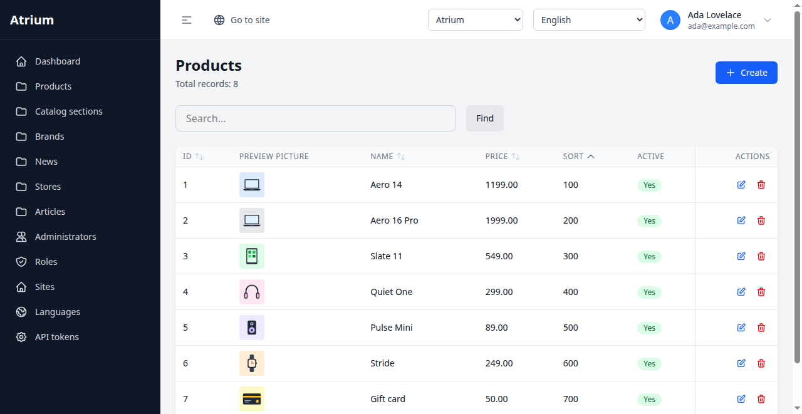
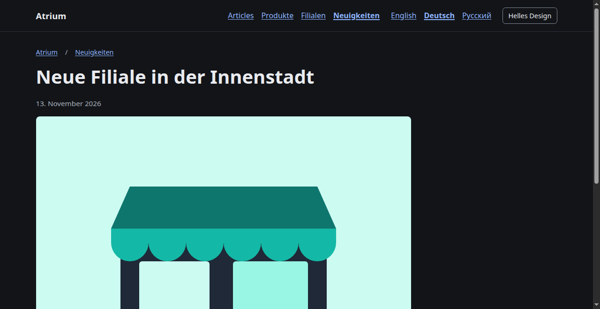

# Atrium

[English](../../README.md) · [Русский](README.ru.md) · **Українська** · [Беларуская](README.be.md) · [Қазақша](README.kk.md) · [Oʻzbekcha](README.uz.md) · [Deutsch](README.de.md) · [Français](README.fr.md) · [Español](README.es.md) · [Português (Brasil)](README.pt-BR.md) · [Italiano](README.it.md) · [Polski](README.pl.md) · [Türkçe](README.tr.md) · [简体中文](README.zh-CN.md) · [日本語](README.ja.md)

[](https://github.com/AlveBy/atrium/actions/workflows/tests.yml)

_Цю сторінку перекладено з англійської машинно. Виправлення вітаються, див. [CONTRIBUTING.md](../../CONTRIBUTING.md)._

Одна адмінка для будь-якої кількості багатомовних сайтів на Laravel 13 і мігратор, який переносить готовий сайт з 1С-Бітрікс.

Модуль описується один раз: модель, її поля та колонки списку. Решту Atrium робить сам: список із пошуком і сортуванням, форму з вкладками, пункт меню, API, а разом із темою ще й сторінки на сайті.



> **До першого релізу.** Atrium працює й покритий тестами, але версія 0.1 ще не вийшла, і пакетів на Packagist поки немає. Спробувати його можна з цього репозиторію.

## Що вміє

- **Багато сайтів.** Одна адмінка й одна база для багатьох сайтів. Сайт визначається за доменом або за папкою на ньому (`example.com/site2/`), мови в кожного свої.
- **Багато мов.** Адмінка розмовляє 15 мовами, кожен адміністратор обирає свою. Мови контенту додаються в адмінці, перекладною можна зробити будь-яку колонку модуля, а в кожної мови свої адреси (`/de/…`) і `hreflang`.
- **20 типів полів.** Текст, числа, дати, списки, зв'язки з іншими модулями, зображення, галереї, файли, візуальний редактор, карти, множинні значення. Форма поділена на вкладки, як в 1С-Бітрікс.
- **Ролі та права.** Хто який модуль бачить і що в ньому може робити: переглядати, створювати, редагувати, видаляти.
- **SEO без програміста.** Заголовки й описи для кожного запису, зрозумілі адреси з переадресацією зі старих, `sitemap.xml` і `robots.txt` для кожного сайту. Google Tag, Яндекс Метрика й коди підтвердження задаються в адмінці для кожного сайту.
- **API.** Токени з доступом лише до вибраних модулів і дій; `/api/v1` сам розповідає, що в ньому є. ШІ-асистенти (Claude, ChatGPT, Cursor) підключаються до `/mcp` з тим самим токеном і рівно з його правами.
- **Код входу на пошту.** Двофакторний вхід увімкнено за замовчуванням.
- **Мігратор з 1С-Бітрікс.** Інфоблоки, властивості, розділи, форми, розкладки списків, SEO та медіабібліотека перетворюються на моделі Laravel, міграції й дані, а звіт порівнює старий сайт із новим.
- **Тема для сайту.** Нейтральний сайт, який малює будь-який модуль за його формою в адмінці. Світла й темна, читається за будь-якого колірного зору.
- **Тести.** PHPUnit на SQLite, MySQL і PostgreSQL, браузерні тести на Laravel Dusk.

| Форма запису | Сайт, світлий і темний |
|---|---|
|  |   |

## Спробувати

З Docker більше нічого не потрібно:

```bash
git clone https://github.com/AlveBy/atrium.git
cd atrium
docker compose up
```

Перший запуск триває кілька хвилин. Потім відкрийте http://localhost:8000/admin і увійдіть як `admin@example.com` з паролем `password` (лише для спроб на власному комп'ютері). Сайт — на http://localhost:8000.

Без Docker потрібні PHP 8.3 або новіший і Composer. База за замовчуванням — SQLite, а адмінка вже зібрана, тож ні MySQL, ні Node не потрібні:

```bash
git clone https://github.com/AlveBy/atrium.git
cd atrium
composer install
cp .env.example .env
php artisan key:generate
php artisan atrium:install --demo
php artisan serve
```

Інсталятор запитає ім'я, пошту й пароль першого адміністратора. Код входу надходить поштою; на власному комп'ютері без пошти він лежить у кінці `storage/logs/laravel.log`, а вимкнути його можна рядком `ATRIUM_2FA_ENABLED=false` у `.env`.

`--demo` додає невеликий магазин: товари з усіма типами полів, бренди, магазини, новини трьома мовами й другий сайт. Щоб почати спочатку, видаліть `database/database.sqlite` і встановіть ще раз.

## Перший модуль

```bash
php artisan atrium:make-module Article
php artisan migrate
```

Команда створює модель, міграцію й рядок у `config/atrium.php`, і в меню з'являється «Articles». Модель описує свою форму та список:

```php
class Article extends Model implements Administrable
{
    use InteractsWithAdmin, Translatable;

    protected array $translatable = ['name', 'code', 'preview_text', 'detail_text'];

    public static function getAdministrationFields(): array
    {
        return [
            TextField::make('name')->label('Name')->required(),
            SlugField::make('code')->label('Code')->from('name')->unique('articles', 'code'),
            CheckboxField::make('active')->label('Active')->default(true),
            ContentField::make('detail_text')->label('Detail text'),
        ];
    }

    public static function getAdministrationListColumns(): array
    {
        return [
            TextColumn::make('name')->label('Name')->sortable()->searchable(),
            BooleanColumn::make('active')->label('Active'),
        ];
    }
}
```

Щоб у модуля з'явилися сторінки на сайті, додайте його до `public_urls` у `config/atrium.php`:

```php
'public_urls' => [
    App\Models\Article::class => ['prefix' => 'articles'],
],
```

## Переїзд з 1С-Бітрікс

```bash
composer require alveby/atrium-bitrix --dev
php artisan atrium:bitrix:migrate
php artisan atrium:bitrix:parity
```

База Бітрікса лише читається. Вкладки, порядок полів і колонки списків виходять такими, якими їх налаштували редактори в Бітріксі. `atrium:bitrix:sync` підтягує правки, які вносять на старому сайті, поки він ще працює. Покроково: [packages/bitrix/README.md](../../packages/bitrix/README.md) (англійською).

## Документація

- [Встановлення: власний сервер, хостинг з ISPmanager або cPanel, Docker](../installation.md)
- [Налаштування: пошта й код входу, файли, API-токени, ШІ-асистенти через MCP](../configuration.md)
- [ШІ-помічник для текстів: безкоштовні й платні провайдери, описи, SEO, alt, переклади](../ai.md)
- [Власний модуль: поля, колонки, вкладки, права, мови, тести, пакет](../modules.md)
- [Переїзд з 1С-Бітрікс крок за кроком](../bitrix.md)

## Пакети

| Пакет | Що це |
|---|---|
| [`alveby/atrium`](../../packages/admin) | Адмінка |
| [`alveby/atrium-theme`](../../packages/theme/README.md) | Тема для сайту |
| [`alveby/atrium-bitrix`](../../packages/bitrix/README.md) | Мігратор з 1С-Бітрікс |
| [`alveby/atrium-ai`](../../packages/ai/README.md) | ШІ-помічник для текстів в адмінці |
| [`alveby/atrium-docs`](../../packages/docs/README.md) | Документація з Markdown: версії та пошук |

Коли 0.1 з'явиться на Packagist, у готовий застосунок на Laravel 13 Atrium встановлюватиметься так:

```bash
composer require alveby/atrium
php artisan atrium:install
```

## Вимоги

- PHP 8.3 або новіший
- Laravel 13
- SQLite, MySQL 8 або PostgreSQL

## Мови

Адмінка розмовляє англійською, російською, українською, білоруською, казахською, узбецькою, німецькою, французькою, іспанською, португальською (Бразилія), італійською, польською, турецькою, китайською (спрощеною) та японською. Англійську й російську написано вручну, решта починалася з машинного перекладу, як і цей README іншими мовами. Виправлення від носіїв мови — один із найкращих перших внесків у проєкт, докладніше в [CONTRIBUTING.md](../../CONTRIBUTING.md) (англійською).

## Як усе починалося

Atrium з’явився в грудні 2025 року в [AlveSoft](https://alve.by) як наша власна адмінка на заміну 1С-Бітрікс для сайту замовника [arkaim.by](https://arkaim.by). Хотілося адмінку, у якій редактору так само звично, як у Бітріксі, але на звичайному Laravel, і мігратор, який перенесе вміст без втрат. Від літа 2026 року панель працює на цьому сайті: редактори щодня ведуть у ній вміст, а мігратор переніс туди весь каталог, сторінки та форми.

У листопаді 2026 року ми вирішили віддати її всім. Прибрали все, що стосувалося того єдиного сайту, а решту виклали під ліцензією MIT, щоб будь-хто міг безкоштовно користуватися нею, змінювати її і будувати на ній свої сайти.

## Що далі

[План розвитку](../../ROADMAP.md) (англійською): модулі, що встановлюються однією командою, готові сайти, переїзд з WordPress і Drupal, інтернет-магазин, 1С і Бітрікс24.

## Участь

У [CONTRIBUTING.md](../../CONTRIBUTING.md) описано, як розгорнути проєкт, запустити тести й перекладати. Про вразливості повідомляйте так, як описано в [SECURITY.md](../../SECURITY.md).

## Ліцензія

MIT, див. [LICENSE](../../LICENSE).

Якщо Atrium вам допоміг, будь ласка, залиште посилання «Зроблено на Atrium» у футері сайту. Це прохання, а не умова ліцензії: MIT вимагає лише зберігати повідомлення про авторське право в копіях коду.
