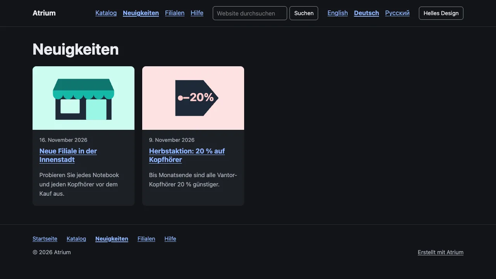

# Atrium

[English](../../README.md) · [Русский](README.ru.md) · [Українська](README.uk.md) · [Беларуская](README.be.md) · [Қазақша](README.kk.md) · **Oʻzbekcha** · [Deutsch](README.de.md) · [Français](README.fr.md) · [Español](README.es.md) · [Português (Brasil)](README.pt-BR.md) · [Italiano](README.it.md) · [Polski](README.pl.md) · [Türkçe](README.tr.md) · [简体中文](README.zh-CN.md) · [日本語](README.ja.md)

[](https://github.com/AlveBy/atrium/actions/workflows/tests.yml) [](../testing.md)

_Bu sahifa ingliz tilidan mashina yordamida tarjima qilingan. Tuzatishlar mamnuniyat bilan qabul qilinadi, batafsil: [CONTRIBUTING.md](../../CONTRIBUTING.md)._

Laravel 13 asosidagi, istalgancha koʻp tilli saytlar uchun bitta administrator paneli va mavjud 1C-Bitrix saytini koʻchirib oʻtkazadigan migrator.

Modul bir marta tavsiflanadi: maydonlari va roʻyxat ustunlari bilan model sifatida. Atrium unga qidiruv va saralash imkoniyati bor roʻyxat, yorliqlarga boʻlingan forma, menyu bandi, API va mavzu bilan birga saytdagi ochiq sahifalarni beradi.


> **Birinchi relizgacha.** Atrium ishlaydi va testlar bilan qamrab olingan, lekin 0.1 versiyasi hali chiqmagan, paketlar esa hali Packagist saytida yoʻq. Uni shu repozitoriydan sinab koʻring.

## Nimalar qila oladi

- **Koʻp saytlilik.** Koʻplab saytlar uchun bitta administrator paneli va bitta maʼlumotlar bazasi; har bir sayt oʻz domeni yoki undagi papka (`example.com/site2/`) orqali aniqlanadi va oʻz tillariga ega.
- **Koʻp tillilik.** Administrator paneli 15 tilda ishlaydi, har bir administrator oʻz tilini tanlaydi. Kontent tillari administrator panelida qoʻshiladi, modulning istalgan ustunini tarjima qilinadigan qilish mumkin, har bir tilning esa oʻz manzillari (`/de/…`) va `hreflang` qiymati bor.
- **20 xil maydon turi.** Matn, sonlar, sanalar, roʻyxatlar, boshqa modullarga bogʻlanishlar, rasmlar, galereyalar, fayllar, vizual muharrir, xaritalar, takrorlanuvchi qiymatlar. Formalar xuddi 1C-Bitrix kabi yorliqlarga boʻlingan.
- **Rollar va huquqlar.** Kim qaysi modulni koʻradi va unda nima qila oladi: koʻrish, yaratish, tahrirlash, oʻchirish.
- **Kod yozmasdan SEO.** Har bir yozuv uchun sarlavha va tavsif, eski manzillardan qayta yoʻnaltiriladigan tushunarli manzillar, har bir sayt uchun `sitemap.xml` va `robots.txt`. Google Tag, Yandex Metrica va tasdiqlash kodlari administrator panelida har bir sayt uchun alohida sozlanadi.
- **API.** Faqat tanlangan modullar va amallar bilan cheklangan tokenlar; `/api/v1` oʻzini oʻzi tavsiflaydi. SI-yordamchilar (Claude, ChatGPT, Cursor) `/mcp` ga xuddi shu token bilan va aynan uning huquqlari bilan ulanadi.
- **E-pochtaga keladigan kirish kodi.** Ikki bosqichli kirish sukut boʻyicha yoqilgan.
- **1C-Bitrix migratori.** Infobloklar, xususiyatlar, boʻlimlar, formalar, roʻyxat koʻrinishlari, SEO va media kutubxona Laravel modellari, migratsiyalar va maʼlumotlarga aylanadi, hisobot esa eski saytni yangisi bilan solishtiradi.
- **Sayt mavzusi.** Har bir modulni administrator panelidagi formasi asosida chizadigan neytral sayt: yorugʻ va qorongʻi, ranglarni har qanday idrok etishda ham oson oʻqiladi.
- **Testlangan.** PHPUnit testlari SQLite, MySQL va PostgreSQL bazalarida, brauzer testlari Laravel Dusk yordamida.

| Yozuv shakli | Admin panelda qidiruv |
|---|---|
|  |  |

| Menyular | Boshqaruv paneli |
|---|---|
|  |  |

| Sayt, yorug' mavzu | Sayt, qorong'i mavzu |
|---|---|
|  |  |

## Sifat

- Har bir pull requestda 6500 dan ortiq PHPUnit testi va Laravel Duskdagi 80 dan ortiq brauzer testi ishga tushadi.
- SQLite, MySQL va PostgreSQLda, PHP 8.3 va 8.4 ostida.
- Har bir paket satrlarining 100% i testlar bilan qoplangan, CI esa biror satrni testsiz qoldiradigan oʻzgarishni oʻtkazmaydi.
- Oʻzgartirilgan kod mutatsion testdan 100% oʻtishi kerak: Infection har bir oʻzgartirilgan satrni buzadi va har bir buzilishda bitta test yiqilishi kerak.
- Bu tekshiruvlardan hech narsa chiqarib tashlanmagan: «tekshirmaslik» belgilari ham, oʻchirilgan mutatorlar ham yoʻq.
- Har bir push maʼlum zaifliklari bor bogʻliqliklarga va git tarixidagi parol va kalitlarga tekshiriladi.

[Testlar va tekshiruvlar qanday ishlaydi](../testing.md).

## Sinab koʻrish

Docker bilan boshqa hech narsa kerak emas:

```bash
git clone -b stable https://github.com/AlveBy/atrium.git
cd atrium
docker compose up
```

Birinchi ishga tushirish bir necha daqiqa davom etadi. Soʻng http://localhost:8000/admin manzilini oching va `admin@example.com` sifatida `password` paroli bilan kiring (faqat oʻz kompyuteringizda sinab koʻrish uchun). Sayt http://localhost:8000 manzilida ochiladi.

Docker boʻlmasa, PHP 8.3 yoki undan yangisi va Composer kerak boʻladi. Sukut boʻyicha maʼlumotlar bazasi SQLite, administrator paneli esa oldindan yigʻilgan, shuning uchun MySQL ham, Node ham kerak emas:

```bash
git clone -b stable https://github.com/AlveBy/atrium.git
cd atrium
composer install
cp .env.example .env
php artisan key:generate
php artisan atrium:install --demo
php artisan serve
```

Oʻrnatuvchi birinchi administratorning ismi, e-pochtasi va parolini soʻraydi. Kirish kodi e-pochtaga yuboriladi; pochta sozlanmagan mahalliy kompyuterda u `storage/logs/laravel.log` faylining oxirida boʻladi, yoki uni `.env` faylida `ATRIUM_2FA_ENABLED=false` qatori bilan oʻchirib qoʻyishingiz mumkin.

`--demo` kichik internet-doʻkon qoʻshadi: barcha maydon turlari bor mahsulotlar, brendlar, doʻkonlar, uch tildagi yangiliklar va ikkinchi sayt. Qaytadan boshlash uchun `database/database.sqlite` faylini oʻchiring va qayta oʻrnating.

## Birinchi modulingiz

```bash
php artisan atrium:make-module Article
php artisan migrate
```

Bu buyruq model, migratsiya va `config/atrium.php` faylida bitta qator yaratadi, menyuda esa “Articles” paydo boʻladi. Model oʻz formasi va roʻyxatini tavsiflaydi:

```php
class Article extends Model implements Administrable
{
    use InteractsWithAdmin, Translatable;

    protected array $translatable = ['name', 'code', 'preview_text', 'detail_text'];

    public static function getAdministrationFields(): array
    {
        return [
            TextField::make('name')->label(__('atrium::fields.standard.name'))->required(),
            SlugField::make('code')->label(__('atrium::fields.standard.code'))->from('name')->unique('articles', 'code'),
            CheckboxField::make('active')->label(__('atrium::fields.standard.active'))->default(true),
            ContentField::make('detail_text')->label(__('atrium::fields.standard.detail_text')),
        ];
    }

    public static function getAdministrationListColumns(): array
    {
        return [
            TextColumn::make('name')->label(__('atrium::fields.standard.name'))->sortable()->searchable(),
            BooleanColumn::make('active')->label(__('atrium::fields.standard.active')),
        ];
    }
}
```

Modulning saytda sahifalari boʻlishi uchun uni `config/atrium.php` faylidagi `public_urls` roʻyxatiga qoʻshing:

```php
'public_urls' => [
    App\Models\Article::class => ['prefix' => 'articles'],
],
```

## 1C-Bitrix saytidan koʻchib oʻtish

```bash
composer require alveby/atrium-bitrix --dev
php artisan atrium:bitrix:migrate
php artisan atrium:bitrix:parity
```

Bitrix maʼlumotlar bazasi faqat oʻqiladi. Yorliqlar, maydonlar tartibi va roʻyxat ustunlari muharrirlar ularni Bitrix tizimida qanday sozlagan boʻlsa, xuddi shunday oʻtadi. `atrium:bitrix:sync` eski sayt hali ishlab turganda unga kiritilgan tahrirlarni ham yetkazib turadi. Bosqichma-bosqich: [packages/bitrix/README.md](../../packages/bitrix/README.md) (ingliz tilida).

## Hujjatlar

- [Oʻrnatish: oʻz serveringiz, ISPmanager yoki cPanel hostingi, Docker](../installation.md)
- [Ommaviy demo: Docker, har soatda tiklash, tashrif buyuruvchi nima qila oladi, qayerda joylashtirish](../demo.md)
- [Sozlash: pochta va kirish kodi, fayllar, API tokenlar, MCP orqali SI-yordamchilar](../configuration.md)
- [Matnlar uchun SI-yordamchi: bepul va pullik provayderlar, tavsiflar, SEO, alt, tarjimalar](../ai.md)
- [SEO: sarlavhalar, hreflang, sayt xaritalari, schema.org, yoʻnaltirishlar, SEO tekshiruvi](../seo.md)
- [Menyular: sarlavha va pastki qism, havolalar daraxti, modulni ochadigan bandlar](../menus.md)
- [Formalar: ustunlardagi konstruktor, sahifani qayta yuklamasdan yuborish, oynada, o‘z belgilashingiz va fetch](../forms.md)
- [Qo‘shimchalar: matn ichidagi forma yoki blok va modul o‘z turini qanday ro‘yxatdan o‘tkazadi](../embeds.md)
- [Bloklar: bir marta yozilgan telefon yoki yozuv shablonlar va matnlarda ko‘rsatiladi](../blocks.md)
- [Qidiruv: natijalar sahifasi, admin paneldagi qator, nima va qanday qidiriladi](../search.md)
- [Oʻz modulingiz: maydonlar, ustunlar, yorliqlar, huquqlar, tillar, testlar, paket](../modules.md)
- [Kengaytmalar: platforma loyihasi — kodsiz konstruktor, formulalar, plaginlar, tashqi ilovalar, reja](../extensions.md)
- [Oʻz maydonlaringiz: istalgan modulga admin paneldan maydon qoʻshish, 100 000 yozuvda filtrlar va fasetlar](../custom-fields.md)
- [Import va eksport: istalgan modul uchun CSV va Excel, ustunlar, yozishdan oldin tekshiruv, konsol va jadval](../import-export.md)
- [Kesh: oʻnlab xususiyatli tez sahifalar, Redis, sahifalar keshi, CDN sarlavhalari](../cache.md)
- [1C-Bitrixdan koʻchish, qadamma-qadam](../bitrix.md)
- [WordPress’dan koʻchish: bazani ulash, koʻchirish, tekshirish, 301 xaritasi](../wordpress.md)
- [Zaxira nusxalar: bazalar va fayllar bir nechta joyga, jadval, tekshiruvlar, tiklash](../backup.md)
- [Xatolar: PHP, navbat va JavaScript xatolari sayt bazasida, ogohlantirishlar, Sentry va oʻz drayverlaringiz](../errors.md)
- [Tezlik va mavjudlik: server o‘lchovlari, tashrifchilarning Web Vitals ko‘rsatkichlari, xabarnomali mavjudlik tekshiruvlari](../monitoring.md)
- [Integratsiyalar: 1C va Bitrix24 konnektorlarining asosi, qayta urinishli navbat, almashinuv jurnali, administratorlarga xabarnomalar](../integrations.md)
- [Bitrix24: formalardan kelgan arizalar lidlar yoki bitimlarga aylanadi, saytdagi chat vidjeti, bitta qo'yilgan vebxuk](../bitrix24.md)
- [1C: 1C:Enterprise katalogi standart CommerceML almashinuvi orqali, almashinuv ekrani](../1c.md)
- [CDN: rasmlar, kichraytirilgan nusxalar va WebP/AVIF, keshni tozalash, S3 ga yuklash](../cdn.md)
- [Ikki bosqichli kirish: autentifikator ilovalari, passkey kalitlari, kodlar, kirish jurnali](../two-factor.md)
- [Ijtimoiy tarmoq orqali kirish: provayderlar, ilovani roʻyxatdan oʻtkazish, yoʻnaltirish manzillari](../social-login.md)

## Paketlar

| Paket | Bu nima |
|---|---|
| [`alveby/atrium`](../../packages/admin) | Administrator paneli |
| [`alveby/atrium-theme`](../../packages/theme/README.md) | Sayt mavzusi |
| [`alveby/atrium-bitrix`](../../packages/bitrix/README.md) | 1C-Bitrix migratori |
| [`alveby/atrium-ai`](../../packages/ai/README.md) | Admin panelda matnlar uchun SI-yordamchi |
| [`alveby/atrium-custom-fields`](../../packages/custom-fields/README.md) | Istalgan modulga admin paneldan qoʻshiladigan maydonlar, filtrlar va fasetlar bilan |
| [`alveby/atrium-seo`](../../packages/seo/README.md) | Meta-teg andozalari, hreflang, sayt xaritalari, schema.org, yoʻnaltirishlar va SEO tekshiruvi |
| [`alveby/atrium-docs`](../../packages/docs/README.md) | Markdown’dan hujjatlar: versiyalar va qidiruv |
| [`alveby/atrium-backup`](../../packages/backup/README.md) | Bazalar va fayllarning zaxira nusxalari, admin paneldan tiklash |
| [`alveby/atrium-errors`](../../packages/errors/README.md) | Sayt bazasida xatolar hisobi, ogohlantirishlar, Sentry |
| [`alveby/atrium-monitoring`](../../packages/monitoring/README.md) | Server va tashrifchilar tezligi, mavjudlik va xabarnomalar, tashqi xizmatlarsiz |
| [`alveby/atrium-integrations`](../../packages/integrations/README.md) | Konnektorlar asosi: qayta urinishli navbat, almashinuv jurnali, nosozlik haqida xabarnoma |
| [`alveby/atrium-bitrix24`](../../packages/bitrix24/README.md) | Formalardan Bitrix24 ga lid yoki bitim sifatida arizalar, chat vidjeti |
| [`alveby/atrium-1c`](../../packages/onec/README.md) | CommerceML orqali 1C dan mahsulotlar, narxlar va qoldiqlar |
| [`alveby/atrium-news`](../../packages/news/README.md) | Yangiliklar |
| [`alveby/atrium-pages`](../../packages/pages/README.md) | Statik sahifalar, 1C-Bitrix sahifalarini import qilish bilan |
| [`alveby/atrium-catalog`](../../packages/catalog/README.md) | Ichki boʻlimli mahsulotlar katalogi |
| [`alveby/atrium-brands`](../../packages/brands/README.md) | Logotipli brendlar |
| [`alveby/atrium-stores`](../../packages/stores/README.md) | Xaritadagi doʻkonlar va ofislar |
| [`alveby/atrium-team`](../../packages/team/README.md) | Odamlar, boʻlimlar va kontaktlar |
| [`alveby/atrium-faq`](../../packages/faq/README.md) | Savollar va javoblar |
| [`alveby/atrium-forms`](../../packages/forms/README.md) | Shakl konstruktori va arizalar |
| [`alveby/atrium-blocks`](../../packages/blocks/README.md) | Bloklar: bir marta yozilgan telefon yoki yozuv, istalgan joyda ko‘rsatiladi |
| [`alveby/atrium-reviews`](../../packages/reviews/README.md) | Moderatsiyali sharhlar va baholar |
| [`alveby/atrium-2fa`](../../packages/two-factor/README.md) | Ikki bosqichli va parolsiz kirish |
| [`alveby/atrium-social-login`](../../packages/social-login/README.md) | Google, Microsoft, Apple, GitHub, Telegram va boshqalar orqali kirish |
| [`alveby/atrium-solutions`](../../packages/solutions/README.md) | Bitta buyruq bilan oʻrnatiladigan tayyor saytlar |
| [`alveby/atrium-menus`](../../packages/menus/README.md) | Admin panelda yig‘iladigan menyular |
| [`alveby/atrium-search`](../../packages/search/README.md) | Barcha modullar bo‘yicha saytdan qidiruv |
| [`alveby/atrium-wordpress`](../../packages/wordpress/README.md) | WordPress importeri: yozuvlar, sahifalar, oʻz yozuv turlari, SEO va tarjimalar, tekshiruv va 301 xaritasi bilan |

Paketlar Packagist saytida bor, lekin 0.1 teg bilan belgilanmaguncha faqat ishlab chiqish versiyasi sifatida — shuning uchun uni koʻrsating:

```bash
composer require alveby/atrium:^0.2
php artisan atrium:install
```

## Talablar

- PHP 8.3 yoki undan yangisi
- Laravel 13
- SQLite, MySQL 8 yoki PostgreSQL

## Tillar

Administrator paneli ingliz, rus, ukrain, belarus, qozoq, oʻzbek, nemis, fransuz, ispan, portugal (Braziliya), italyan, polyak, turk, xitoy (soddalashtirilgan) va yapon tillarida ishlaydi. Ingliz va rus tillaridagi matnlar qoʻlda yozilgan; qolganlari mashina tarjimasidan boshlangan, bu README ham shunday. Ona tilida soʻzlashuvchilarning tuzatishlari loyihaga qoʻshiladigan eng yaxshi birinchi hissalardan biri: batafsil [CONTRIBUTING.md](../../CONTRIBUTING.md) (ingliz tilida).

## Hammasi qanday boshlangan

Atrium 2025-yil dekabrida [AlveSoft](https://alve.by) kompaniyasida mijozimiz saytidagi ([arkaim.by](https://arkaim.by)) 1C-Bitrix oʻrniga oʻzimizning administrator panelimiz sifatida paydo boʻldi. Biz muharrirga Bitrixdagidek tanish, lekin oddiy Laravel asosidagi administrator panelini va kontentni yoʻqotishlarsiz koʻchirib oʻtkazadigan migratorni xohlagandik. 2026-yil yozidan beri panel oʻsha saytda ishlayapti: muharrirlar unda har kuni kontent bilan ishlaydi, migrator esa butun katalogni, sahifalar va formalarni koʻchirib oʻtkazdi.

2026-yil noyabrida uni hammaga berishga qaror qildik. Oʻsha bitta saytga tegishli barcha narsani olib tashlab, qolganini MIT litsenziyasi ostida joylashtirdik, shunda har kim undan bepul foydalanishi, uni oʻzgartirishi va oʻz saytlarini uning asosida qurishi mumkin.

## Keyingi qadamlar

[Rivojlanish rejasi](../../ROADMAP.md) (ingliz tilida): bitta buyruq bilan oʻrnatiladigan modullar, tayyor saytlar, WordPress va Drupal saytlaridan import vositalari, internet-doʻkon, 1C va Bitrix24.

## Hissa qoʻshish

[CONTRIBUTING.md](../../CONTRIBUTING.md) faylida loyihani qanday sozlash, testlarni ishga tushirish va tarjima qilish tushuntirilgan. Xavfsizlik muammolari haqida [SECURITY.md](../../SECURITY.md) faylida yozilganidek xabar bering.

## Litsenziya

MIT, qarang: [LICENSE](../../LICENSE).

Agar Atrium sizga yordam bergan bo‘lsa, iltimos, sayt pastki qismidagi “Atrium asosida yaratilgan” havolasini qoldiring. Bu litsenziya sharti emas, balki iltimos: MIT faqat kod nusxalarida mualliflik huquqi haqidagi bildirishnomani saqlashni talab qiladi.
