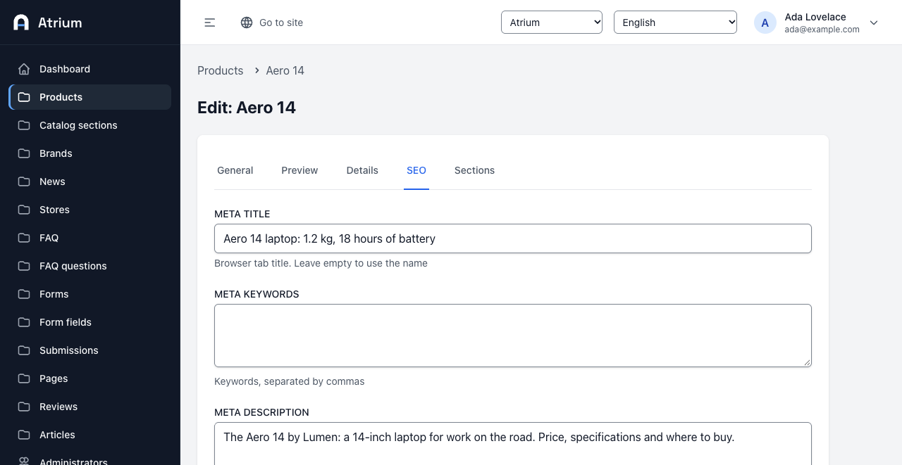
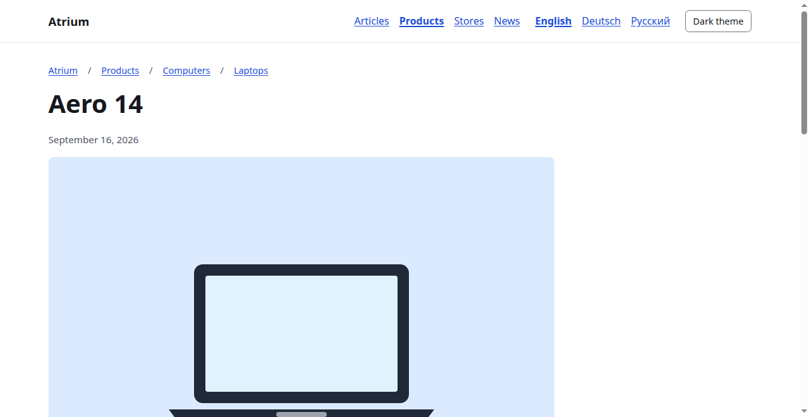

# Atrium

[English](../../README.md) · [Русский](README.ru.md) · [Українська](README.uk.md) · [Беларуская](README.be.md) · [Қазақша](README.kk.md) · **Oʻzbekcha** · [Deutsch](README.de.md) · [Français](README.fr.md) · [Español](README.es.md) · [Português (Brasil)](README.pt-BR.md) · [Italiano](README.it.md) · [Polski](README.pl.md) · [Türkçe](README.tr.md) · [简体中文](README.zh-CN.md) · [日本語](README.ja.md)

[](https://github.com/AlveBy/atrium/actions/workflows/tests.yml)

_Bu sahifa ingliz tilidan mashina yordamida tarjima qilingan. Tuzatishlar mamnuniyat bilan qabul qilinadi, batafsil: [CONTRIBUTING.md](../../CONTRIBUTING.md)._

Laravel 13 asosidagi, istalgancha koʻp tilli saytlar uchun bitta administrator paneli va mavjud 1C-Bitrix saytini koʻchirib oʻtkazadigan migrator.

Modul bir marta tavsiflanadi: maydonlari va roʻyxat ustunlari bilan model sifatida. Atrium unga qidiruv va saralash imkoniyati bor roʻyxat, yorliqlarga boʻlingan forma, menyu bandi, API va mavzu bilan birga saytdagi ochiq sahifalarni beradi.


> **Birinchi relizgacha.** Atrium ishlaydi va testlar bilan qamrab olingan, lekin 0.1 versiyasi hali chiqmagan, paketlar esa hali Packagist saytida yoʻq. Uni shu repozitoriydan sinab koʻring.

## Nimalar qila oladi

- **Koʻp saytlilik.** Koʻplab saytlar uchun bitta administrator paneli va bitta maʼlumotlar bazasi; har bir sayt oʻz domeni yoki undagi papka (`example.com/site2/`) orqali aniqlanadi va oʻz tillariga ega.
- **Koʻp tillilik.** Administrator paneli 15 tilda ishlaydi, har bir administrator oʻz tilini tanlaydi. Kontent tillari administrator panelida qoʻshiladi, modulning istalgan ustunini tarjima qilinadigan qilish mumkin, har bir tilning esa oʻz manzillari (`/de/…`) va `hreflang` qiymati bor.
- **20 xil maydon turi.** Matn, sonlar, sanalar, roʻyxatlar, boshqa modullarga bogʻlanishlar, rasmlar, galereyalar, fayllar, vizual muharrir, xaritalar, takrorlanuvchi qiymatlar. Formalar xuddi 1C-Bitrix kabi yorliqlarga boʻlingan.
- **Rollar va huquqlar.** Kim qaysi modulni koʻradi va unda nima qila oladi: koʻrish, yaratish, tahrirlash, oʻchirish.
- **Kod yozmasdan SEO.** Har bir yozuv uchun sarlavha va tavsif, eski manzillardan qayta yoʻnaltiriladigan tushunarli manzillar, har bir sayt uchun `sitemap.xml` va `robots.txt`. Google Tag, Yandex Metrica va tasdiqlash kodlari administrator panelida har bir sayt uchun alohida sozlanadi.
- **API.** Faqat tanlangan modullar va amallar bilan cheklangan tokenlar; `/api/v1` oʻzini oʻzi tavsiflaydi. SI-yordamchilar (Claude, ChatGPT, Cursor) `/mcp` ga xuddi shu token bilan va aynan uning huquqlari bilan ulanadi.
- **E-pochtaga keladigan kirish kodi.** Ikki bosqichli kirish sukut boʻyicha yoqilgan.
- **1C-Bitrix migratori.** Infobloklar, xususiyatlar, boʻlimlar, formalar, roʻyxat koʻrinishlari, SEO va media kutubxona Laravel modellari, migratsiyalar va maʼlumotlarga aylanadi, hisobot esa eski saytni yangisi bilan solishtiradi.
- **Sayt mavzusi.** Har bir modulni administrator panelidagi formasi asosida chizadigan neytral sayt: yorugʻ va qorongʻi, ranglarni har qanday idrok etishda ham oson oʻqiladi.
- **Testlangan.** PHPUnit testlari SQLite, MySQL va PostgreSQL bazalarida, brauzer testlari Laravel Dusk yordamida.

| Yozuv formasi | Sayt, yorugʻ va qorongʻi |
|---|---|
|  |   |

## Sinab koʻrish

Docker bilan boshqa hech narsa kerak emas:

```bash
git clone https://github.com/AlveBy/atrium.git
cd atrium
docker compose up
```

Birinchi ishga tushirish bir necha daqiqa davom etadi. Soʻng http://localhost:8000/admin manzilini oching va `admin@example.com` sifatida `password` paroli bilan kiring (faqat oʻz kompyuteringizda sinab koʻrish uchun). Sayt http://localhost:8000 manzilida ochiladi.

Docker boʻlmasa, PHP 8.3 yoki undan yangisi va Composer kerak boʻladi. Sukut boʻyicha maʼlumotlar bazasi SQLite, administrator paneli esa oldindan yigʻilgan, shuning uchun MySQL ham, Node ham kerak emas:

```bash
git clone https://github.com/AlveBy/atrium.git
cd atrium
composer install
cp .env.example .env
php artisan key:generate
php artisan atrium:install --demo
php artisan serve
```

Oʻrnatuvchi birinchi administratorning ismi, e-pochtasi va parolini soʻraydi. Kirish kodi e-pochtaga yuboriladi; pochta sozlanmagan mahalliy kompyuterda u `storage/logs/laravel.log` faylining oxirida boʻladi, yoki uni `.env` faylida `ATRIUM_2FA_ENABLED=false` qatori bilan oʻchirib qoʻyishingiz mumkin.

`--demo` kichik internet-doʻkon qoʻshadi: barcha maydon turlari bor mahsulotlar, brendlar, doʻkonlar, uch tildagi yangiliklar va ikkinchi sayt. Qaytadan boshlash uchun `database/database.sqlite` faylini oʻchiring va qayta oʻrnating.

## Birinchi modulingiz

```bash
php artisan atrium:make-module Article
php artisan migrate
```

Bu buyruq model, migratsiya va `config/atrium.php` faylida bitta qator yaratadi, menyuda esa “Articles” paydo boʻladi. Model oʻz formasi va roʻyxatini tavsiflaydi:

```php
class Article extends Model implements Administrable
{
    use InteractsWithAdmin, Translatable;

    protected array $translatable = ['name', 'code', 'preview_text', 'detail_text'];

    public static function getAdministrationFields(): array
    {
        return [
            TextField::make('name')->label('Name')->required(),
            SlugField::make('code')->label('Code')->from('name')->unique('articles', 'code'),
            CheckboxField::make('active')->label('Active')->default(true),
            ContentField::make('detail_text')->label('Detail text'),
        ];
    }

    public static function getAdministrationListColumns(): array
    {
        return [
            TextColumn::make('name')->label('Name')->sortable()->searchable(),
            BooleanColumn::make('active')->label('Active'),
        ];
    }
}
```

Modulning saytda sahifalari boʻlishi uchun uni `config/atrium.php` faylidagi `public_urls` roʻyxatiga qoʻshing:

```php
'public_urls' => [
    App\Models\Article::class => ['prefix' => 'articles'],
],
```

## 1C-Bitrix saytidan koʻchib oʻtish

```bash
composer require alveby/atrium-bitrix --dev
php artisan atrium:bitrix:migrate
php artisan atrium:bitrix:parity
```

Bitrix maʼlumotlar bazasi faqat oʻqiladi. Yorliqlar, maydonlar tartibi va roʻyxat ustunlari muharrirlar ularni Bitrix tizimida qanday sozlagan boʻlsa, xuddi shunday oʻtadi. `atrium:bitrix:sync` eski sayt hali ishlab turganda unga kiritilgan tahrirlarni ham yetkazib turadi. Bosqichma-bosqich: [packages/bitrix/README.md](../../packages/bitrix/README.md) (ingliz tilida).

## Hujjatlar

- [Oʻrnatish: oʻz serveringiz, ISPmanager yoki cPanel hostingi, Docker](../installation.md)
- [Sozlash: pochta va kirish kodi, fayllar, API tokenlar, MCP orqali SI-yordamchilar](../configuration.md)
- [Matnlar uchun SI-yordamchi: bepul va pullik provayderlar, tavsiflar, SEO, alt, tarjimalar](../ai.md)
- [Oʻz modulingiz: maydonlar, ustunlar, yorliqlar, huquqlar, tillar, testlar, paket](../modules.md)
- [1C-Bitrixdan koʻchish, qadamma-qadam](../bitrix.md)

## Paketlar

| Paket | Bu nima |
|---|---|
| [`alveby/atrium`](../../packages/admin) | Administrator paneli |
| [`alveby/atrium-theme`](../../packages/theme/README.md) | Sayt mavzusi |
| [`alveby/atrium-bitrix`](../../packages/bitrix/README.md) | 1C-Bitrix migratori |
| [`alveby/atrium-ai`](../../packages/ai/README.md) | Admin panelda matnlar uchun SI-yordamchi |
| [`alveby/atrium-docs`](../../packages/docs/README.md) | Markdown’dan hujjatlar: versiyalar va qidiruv |

0.1 versiyasi Packagist saytida paydo boʻlgach, mavjud Laravel 13 ilovasiga Atrium quyidagicha oʻrnatiladi:

```bash
composer require alveby/atrium
php artisan atrium:install
```

## Talablar

- PHP 8.3 yoki undan yangisi
- Laravel 13
- SQLite, MySQL 8 yoki PostgreSQL

## Tillar

Administrator paneli ingliz, rus, ukrain, belarus, qozoq, oʻzbek, nemis, fransuz, ispan, portugal (Braziliya), italyan, polyak, turk, xitoy (soddalashtirilgan) va yapon tillarida ishlaydi. Ingliz va rus tillaridagi matnlar qoʻlda yozilgan; qolganlari mashina tarjimasidan boshlangan, bu README ham shunday. Ona tilida soʻzlashuvchilarning tuzatishlari loyihaga qoʻshiladigan eng yaxshi birinchi hissalardan biri: batafsil [CONTRIBUTING.md](../../CONTRIBUTING.md) (ingliz tilida).

## Keyingi qadamlar

[Rivojlanish rejasi](../../ROADMAP.md) (ingliz tilida): bitta buyruq bilan oʻrnatiladigan modullar, tayyor saytlar, WordPress va Drupal saytlaridan import vositalari, internet-doʻkon, 1C va Bitrix24.

## Hissa qoʻshish

[CONTRIBUTING.md](../../CONTRIBUTING.md) faylida loyihani qanday sozlash, testlarni ishga tushirish va tarjima qilish tushuntirilgan. Xavfsizlik muammolari haqida [SECURITY.md](../../SECURITY.md) faylida yozilganidek xabar bering.

## Litsenziya

MIT, qarang: [LICENSE](../../LICENSE).
