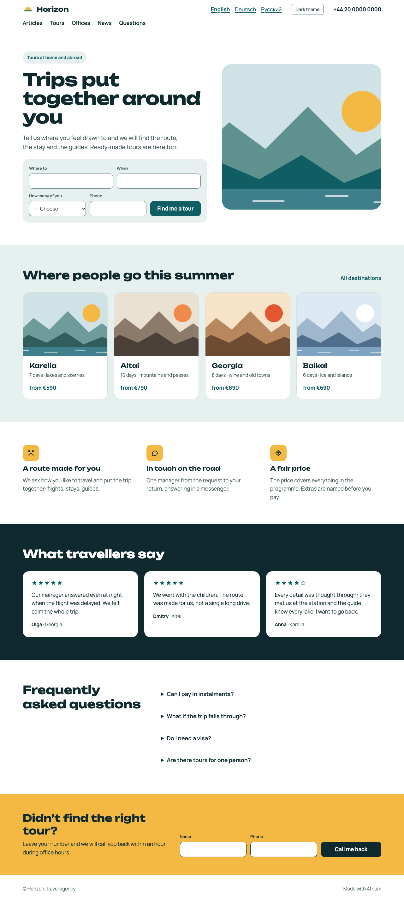
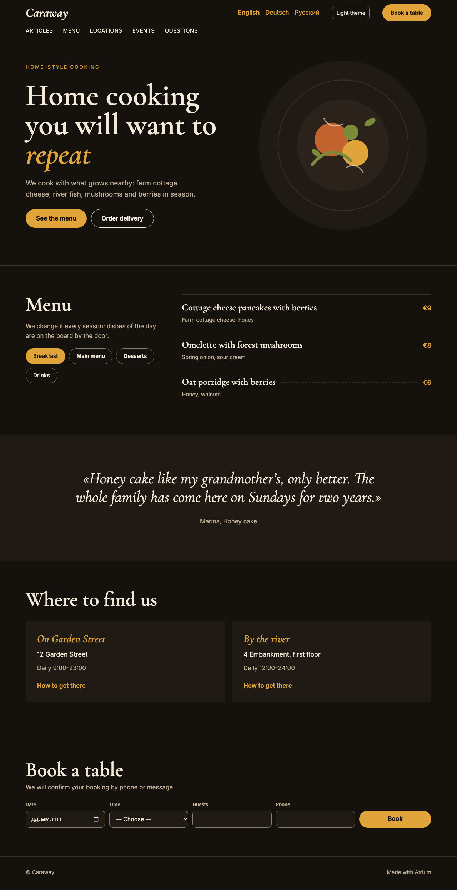
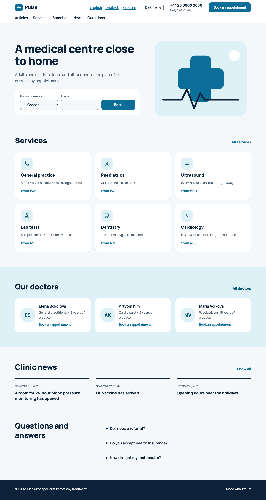
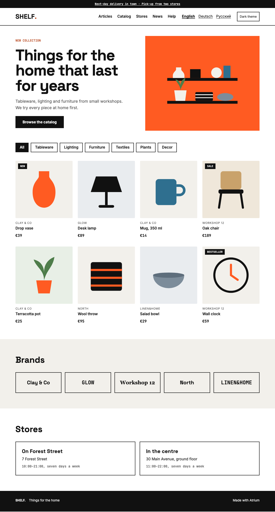

**English** · [Русский](skins.ru.md)

# Skins

The theme (`alveby/atrium-theme`) comes with four skins: a travel agency, a restaurant, a medical centre and a home goods shop. A skin is a palette, its fonts and a home page of its own, built from the modules you have installed.

| Travel agency | Restaurant |
|---|---|
|  |  |
| **Medical centre** | **Home goods shop** |
|  |  |

The names, prices, addresses and phone numbers in the screenshots are made up.

## Switching a skin on

```dotenv
ATRIUM_THEME_SKIN=clinic
```

`travel`, `restaurant`, `clinic` or `shop`; empty, or any other value, is the neutral theme. The restaurant opens dark, the others light; the switch in the header works in every skin and the visitor's choice is kept.

Prices are printed in the site's currency, the way the page's language writes it: `from €1,250` in English, `ab 1.250 €` in German, `от 1 250 €` in Russian. The currency is an ISO 4217 code and does not follow the language:

```dotenv
ATRIUM_THEME_CURRENCY=EUR
```

The formatting needs the PHP `intl` extension.

## Languages and fonts

The skins' headings and buttons are translated into the 15 languages of Atrium (`packages/theme/lang/{locale}/skins.php`). To change a text, put only the lines you change into `lang/vendor/atrium-theme/{locale}/skins.php` of your site; Laravel merges them over the package's.

The fonts are served by your site, never by Google Fonts. `atrium:install` publishes them with the admin's assets; after an update publish them again:

```bash
php artisan vendor:publish --tag=atrium-theme-assets --force
```

They land in `public/vendor/atrium-theme/fonts`: variable WOFF2 with Latin, Latin Extended, Cyrillic and Cyrillic Extended letters, so Polish, Turkish, Uzbek and Kazakh text is drawn in the skin's font. Space Grotesk has no Cyrillic, so Russian headings in the shop fall back to Inter. Chinese and Japanese use the system's fonts (PingFang, Hiragino, Microsoft YaHei, Yu Gothic, Noto Sans CJK), with Japanese glyph shapes on Japanese pages. Until the fonts are published the skin uses the system fonts. The licences (SIL Open Font License) lie next to the files.

Long words, such as German compounds, are hyphenated or broken instead of running out of a card; `tests/Browser/Site/SkinsTest.php` checks that no home page is wider than a phone screen, in English and in German.

## What the home page is made of

Each section comes from a module. A section whose module is not installed, or has nothing to show, is left out, so a site with only the catalog still gets a tidy home page.

| Skin | Sections, top to bottom | Taken from |
|---|---|---|
| travel | hero with the tour request form; tours; why us; reviews; questions; callback form | page `home`, catalog, page `why-us` and its subpages, reviews, FAQ, forms `tour-request` and `callback` |
| restaurant | hero; the menu in tabs by section; a review; addresses and hours; table booking | page `home` and `delivery`, catalog, reviews, stores, form `table-booking` |
| clinic | hero with the appointment form; services; doctors; news; questions | page `home`, catalog, page `doctors` and its subpages, news, FAQ, form `appointment` |
| shop | the newest news as a banner; hero; products with section chips; brands; stores | news, page `home`, catalog, brands, stores |

The hero heading and text are the page `home` of the Pages module, so editors change them in the admin. Opening hours are the first paragraph of a store's text; a doctor's role is the first paragraph of the doctor's page. The phone in the header is the first store's.

## Colours

Each skin keeps its design's colours. Text and links keep at least 4.5:1 against the background and the surface, borders of fields and the focus ring at least 3:1, in light and dark; `packages/theme/tests/SkinsContrastTest.php` checks every pair, so a change that breaks one fails CI. Contrast below is against the background / the surface.

| Skin | | Light | Dark |
|---|---|---|---|
| travel | text | `#0e2a2f` 15.1 / 13.0 | `#e6f0ee` 14.6 / 11.4 |
| | links, buttons | `#0f5e63` 7.5 / 6.4 | `#f4b942` 9.6 / 7.5 |
| | field borders | `#5c7a7d` 4.6 / 4.0 | `#7fa3a3` 6.2 / 4.9 |
| restaurant | text | `#1e1812` 16.2 / 14.2 | `#f3eadb` 15.7 / 14.4 |
| | links, buttons | `#74490a` 7.2 / 6.3 | `#e0a43a` 8.5 / 7.8 |
| | field borders | `#8c7b66` 3.8 / 3.3 | `#8c7b66` 4.6 / 4.2 |
| clinic | text | `#0b2239` 15.1 / 16.1 | `#e7f0f6` 15.2 / 13.4 |
| | links, buttons | `#0b6e99` 5.3 / 5.7 | `#7cc7ea` 9.4 / 8.2 |
| | field borders | `#6b7f90` 3.9 / 4.1 | `#6f8aa0` 4.9 / 4.3 |
| shop | text, links, buttons | `#111111` 18.9 / 16.6 | `#f2f0eb` 16.3 / 14.8 |
| | focus ring | `#b33a0e` 6.0 / 5.2 | `#ff8a5b` 8.0 / 7.2 |

To change a colour, override its custom property after the theme's stylesheet:

```css
:root[data-skin="clinic"] { --brand: #0a5878; --accent: #0a5878; }
```

## Changing a skin

`php artisan vendor:publish --tag=atrium-theme-views` copies the skins' templates too: `resources/views/vendor/atrium-theme/skins/{skin}/` has `home`, `brand`, `footer` and, where the skin has them, `banner` and `actions`. The stylesheets are in the package (`packages/theme/resources/skins`), inline in the page, with nothing to build.

## A skin of your own package

A package adds a skin, or replaces one of the same name, from its service provider:

```php
use Atrium\Theme\Skins\Skin;
use Atrium\Theme\Skins\Skins;

public function boot(): void
{
    $this->loadViewsFrom(__DIR__.'/../resources/views', 'law-office');
    $this->loadTranslationsFrom(__DIR__.'/../lang', 'law-office');

    $this->callAfterResolving(Skins::class, fn (Skins $skins) => $skins->register(
        new Skin('law', ['manrope'], 'light', __DIR__.'/../resources', 'law-office'),
    ));
}
```

The arguments are the name (`ATRIUM_THEME_SKIN=law`), the theme's fonts it uses (`unbounded`, `manrope`, `cormorant-garamond`, `inter`, `space-grotesk`, `jetbrains-mono`), the scheme it opens with, the package's resources folder, and its view and translation namespace. The package then has:

- `resources/skins/law.css`: the colours, fonts and shapes, after what every skin shares;
- `resources/skins/law/*.svg`: pictures for `$skin->illustration('name')`, if it uses any;
- `resources/views/skins/law/home.blade.php`, `brand.blade.php`, `footer.blade.php`, and optionally `banner` and `actions`;
- `lang/{locale}/skins.php` with the texts under `law`; `modules.catalog`, `modules.news` and so on rename the menu items.

Please keep the "Made with Atrium" link in the footer while `config('atrium-theme.credit')` is on; the theme's footers show how.
