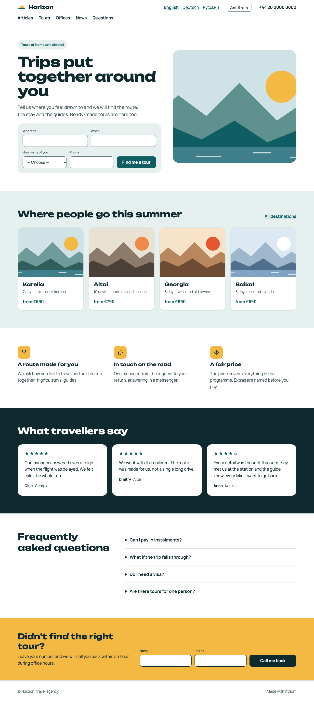
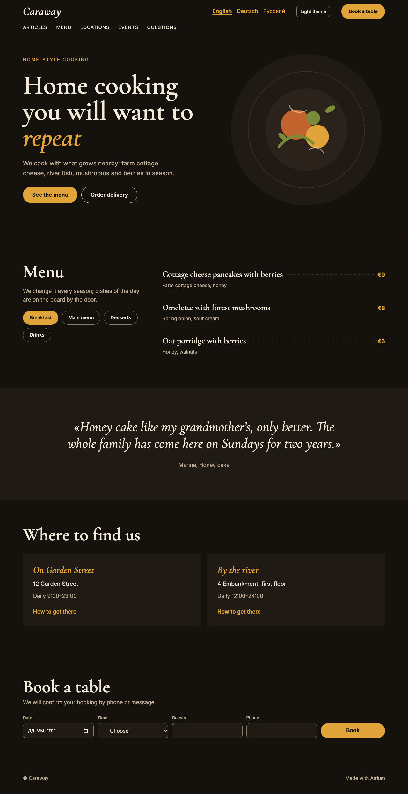
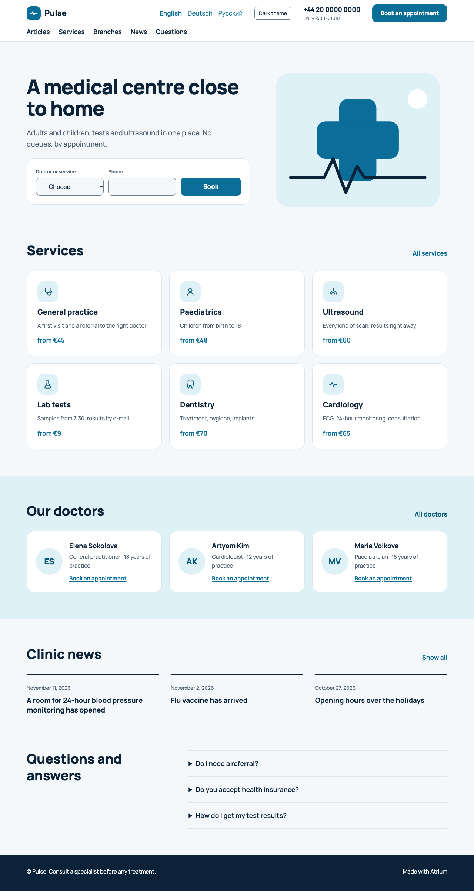
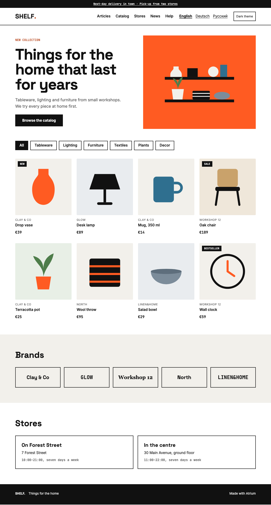
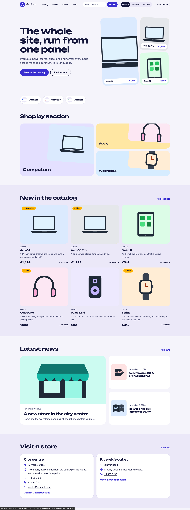
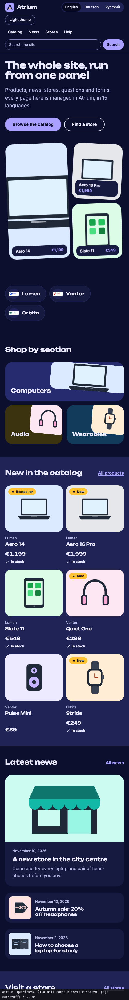
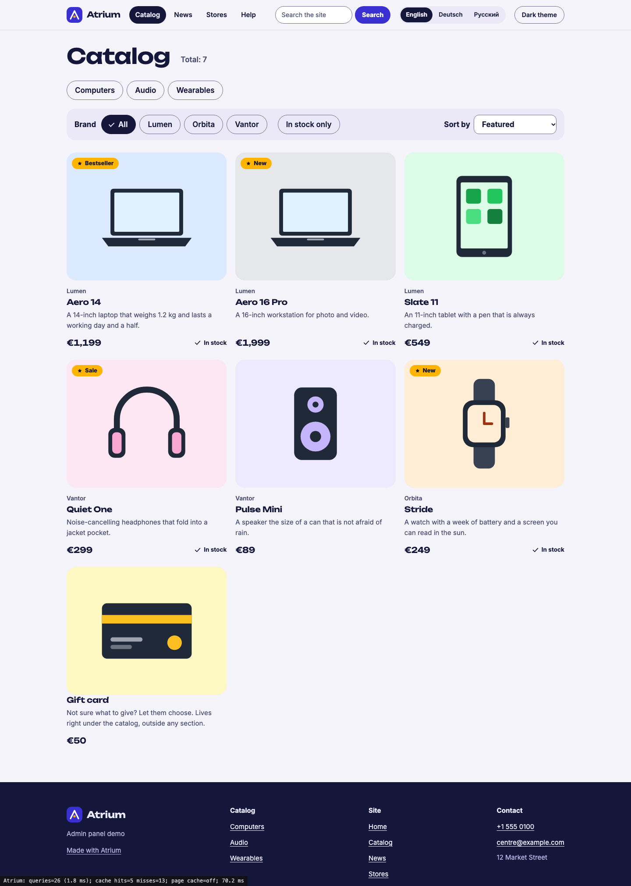
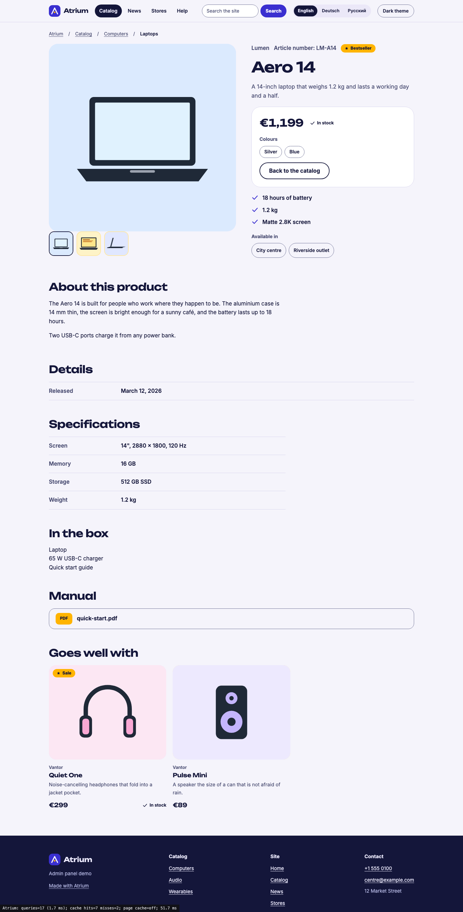
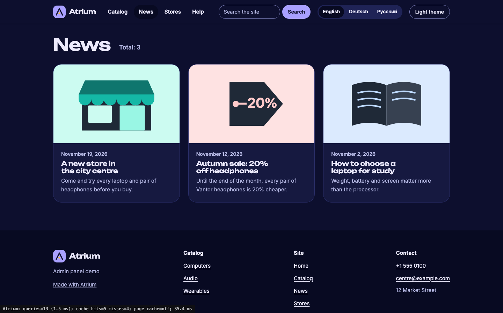
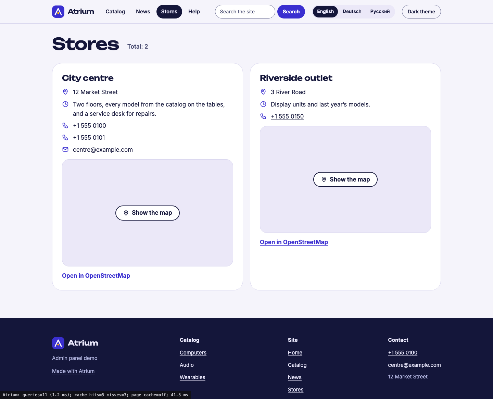

[English](skins.md) · **Русский**

# Скины

В теме (`alveby/atrium-theme`) пять скинов: турагентство, ресторан, медицинский центр, магазин товаров для дома и собственный скин Atrium — тот, что у публичной демо. Скин — это палитра, шрифты и своя главная страница, собранная из установленных модулей.

| Турагентство | Ресторан |
|---|---|
|  |  |
| **Медицинский центр** | **Магазин для дома** |
|  |  |

Названия, цены, адреса и телефоны на снимках выдуманы.

## Скин Atrium

`atrium` — скин публичной демо; он показывает, что умеет тема, когда установлены все модули. В отличие от остальных четырёх, он рисует и внутренние страницы, а не только главную:

- **Главная**: первый экран с тремя свежими товарами плитками, бренды, разделы каталога сеткой, свежие товары, новости, магазины, команда, отзывы, вопросы и форма связи. Блок, чей модуль не установлен или в нём нечего показать, пропускается.
- **Каталог**: чипсы разделов и панель фильтров (бренд, в наличии, сортировка по цене), которая работает без фреймворка: около 40 строк JavaScript, а без него показывается весь список. Число показанных товаров озвучивается экранным чтецам.
- **Товар**: галерея с миниатюрами, бренд, ярлык, цена и отметка наличия «галочка и слова», цвета, особенности, магазины, где он есть, текст, таблица свойств, характеристики, файлы и «с этим покупают».
- **Новости и любая другая запись**: широкая картинка, дата, текст нормальной для чтения ширины.
- **Магазины**: адрес, часы, телефон, e-mail и карта OpenStreetMap, которая загружается только по кнопке **Показать карту**, так что страница не обращается к чужому сайту, пока посетитель не попросит; ссылка «Открыть в OpenStreetMap» работает и без JavaScript.

| Главная, светлая | Главная, тёмная, телефон |
|---|---|
|  |  |
| **Каталог** | **Товар** |
|  |  |
| **Новости** | **Магазины** |
|  |  |

Палитра — индиго и янтарь: они различимы при любом виде дальтонизма (синий против жёлтого), и ничто не держится на одном цвете: ярлык говорит «Новинка», «Скидка» или «Хит», наличие — галочка и слова «В наличии», ссылки подчёркнуты, текущий пункт меню — залитая «таблетка». Заголовки набраны шрифтом Unbounded, текст — Inter, оба отдаются с вашего сайта. Скин открывается светлым или тёмным по системе посетителя и переключателю в шапке.

Страница товара берёт поля каталога по их именам (`price`, `brand`, `label`, `in_stock`, `colors`, `features`, `stores`, `related`, `article`), а все остальные поля формы показывает под текстом. Блоки других модулей, которые сами добавляются под записью (`atrium-theme.record_views`: отзывы, комментарии, форма), идут после него.

У скина могут быть два собственных шаблона: `list` (список модуля и раздел) и `page` (запись); тогда он рисует эти страницы вместо темы; `themeView()` самого модуля по-прежнему главнее. У остальных четырёх скинов их нет.

## Как включить скин

```dotenv
ATRIUM_THEME_SKIN=clinic
```

`travel`, `restaurant`, `clinic`, `shop` или `atrium`; пусто или любое другое значение — нейтральная тема. Ресторан открывается тёмным, остальные светлыми; переключатель в шапке работает в каждом скине, выбор посетителя запоминается.

Цены выводятся в валюте сайта так, как их пишет язык страницы: `from €1,250` по-английски, `ab 1.250 €` по-немецки, `от 1 250 €` по-русски. Валюта — код ISO 4217, от языка она не зависит:

```dotenv
ATRIUM_THEME_CURRENCY=EUR
```

Для форматирования нужно расширение PHP `intl`.

## Языки и шрифты

Заголовки и кнопки скинов переведены на 15 языков Atrium (`packages/theme/lang/{locale}/skins.php`). Чтобы поменять текст, положите только изменённые строки в `lang/vendor/atrium-theme/{locale}/skins.php` своего сайта: Laravel наложит их поверх строк пакета.

Шрифты отдаёт ваш сайт, а не Google Fonts. `atrium:install` публикует их вместе с ассетами админки; после обновления опубликуйте заново:

```bash
php artisan vendor:publish --tag=atrium-theme-assets --force
```

Они лежат в `public/vendor/atrium-theme/fonts`: вариативные WOFF2 с латиницей, расширенной латиницей, кириллицей и расширенной кириллицей, так что польский, турецкий, узбекский и казахский текст тоже набран шрифтом скина. В Space Grotesk нет кириллицы, поэтому русские заголовки в магазине набираются Inter. Китайский и японский берут системные шрифты (PingFang, Hiragino, Microsoft YaHei, Yu Gothic, Noto Sans CJK), на японских страницах — с японским начертанием иероглифов. Пока шрифты не опубликованы, скин пользуется системными. Лицензии (SIL Open Font License) лежат рядом с файлами.

Длинные слова, например немецкие составные, переносятся, а не вылезают из карточки; `tests/Browser/Site/SkinsTest.php` проверяет, что ни одна главная не шире экрана телефона, по-английски и по-немецки.

## Из чего собрана главная

Каждый блок берётся из модуля. Если модуль не установлен или показать нечего, блока нет, так что и сайт с одним каталогом получает аккуратную главную.

| Скин | Блоки сверху вниз | Откуда |
|---|---|---|
| travel | первый экран с формой подбора тура; туры; почему мы; отзывы; вопросы; форма обратного звонка | страница `home`, каталог, страница `why-us` и её подстраницы, отзывы, FAQ, формы `tour-request` и `callback` |
| restaurant | первый экран; меню во вкладках по разделам; отзыв; адреса и часы работы; бронь стола | страницы `home` и `delivery`, каталог, отзывы, магазины, форма `table-booking` |
| clinic | первый экран с записью на приём; услуги; врачи; новости; вопросы | страница `home`, каталог, страница `doctors` и её подстраницы, новости, FAQ, форма `appointment` |
| shop | свежая новость плашкой; первый экран; товары с переключателем разделов; бренды; магазины | новости, страница `home`, каталог, бренды, магазины |
| atrium | первый экран; бренды; разделы; товары; новости; магазины; команда; отзывы; вопросы; форма связи | страница `home`, бренды, каталог, новости, магазины, команда, отзывы, вопросы, форма `contact`, `order` или `callback` |

Заголовок и текст первого экрана — страница `home` модуля «Страницы», редакторы меняют их в админке. Часы работы — первый абзац текста магазина, должность врача — первый абзац его страницы. Телефон в шапке — первого магазина.

## Цвета

Каждый скин держит цвета своего макета. Текст и ссылки — не меньше 4,5:1 к фону и к подложке, рамки полей и обводка фокуса — не меньше 3:1, в светлой и тёмной теме; `packages/theme/tests/SkinsContrastTest.php` проверяет каждую пару, и правка, которая её ломает, роняет CI. Контраст ниже — к фону / к подложке.

| Скин | | Светлая | Тёмная |
|---|---|---|---|
| travel | текст | `#0e2a2f` 15,1 / 13,0 | `#e6f0ee` 14,6 / 11,4 |
| | ссылки, кнопки | `#0f5e63` 7,5 / 6,4 | `#f4b942` 9,6 / 7,5 |
| | рамки полей | `#5c7a7d` 4,6 / 4,0 | `#7fa3a3` 6,2 / 4,9 |
| restaurant | текст | `#1e1812` 16,2 / 14,2 | `#f3eadb` 15,7 / 14,4 |
| | ссылки, кнопки | `#74490a` 7,2 / 6,3 | `#e0a43a` 8,5 / 7,8 |
| | рамки полей | `#8c7b66` 3,8 / 3,3 | `#8c7b66` 4,6 / 4,2 |
| clinic | текст | `#0b2239` 15,1 / 16,1 | `#e7f0f6` 15,2 / 13,4 |
| | ссылки, кнопки | `#0b6e99` 5,3 / 5,7 | `#7cc7ea` 9,4 / 8,2 |
| | рамки полей | `#6b7f90` 3,9 / 4,1 | `#6f8aa0` 4,9 / 4,3 |
| shop | текст, ссылки, кнопки | `#111111` 18,9 / 16,6 | `#f2f0eb` 16,3 / 14,8 |
| | обводка фокуса | `#b33a0e` 6,0 / 5,2 | `#ff8a5b` 8,0 / 7,2 |
| atrium | текст | `#14163a` 15,9 / 17,4 | `#eceafd` 15,8 / 14,2 |
| | второстепенный текст | `#4a4d72` 7,4 / 8,1 | `#b6b9e4` 9,8 / 8,9 |
| | ссылки, кнопки | `#3a2fd0` 7,7 / 8,4 | `#a9a0ff` 8,1 / 7,3 |
| | рамки полей | `#6a6d92` 4,6 / 5,0 | `#8387c4` 5,5 / 5,5 |
| | янтарные ярлыки и чипсы | `#14163a` на `#ffb400` 9,8 | `#14163a` на `#ffc233` 10,8 |
| | текст на тёмных плашках | `#eceafd` 14,7 | `#eceafd` 16,5 |

Чтобы поменять цвет, переопределите его переменную после стилей темы:

```css
:root[data-skin="clinic"] { --brand: #0a5878; --accent: #0a5878; }
```

## Как поменять скин

`php artisan vendor:publish --tag=atrium-theme-views` копирует и шаблоны скинов: в `resources/views/vendor/atrium-theme/skins/{skin}/` лежат `home`, `brand`, `footer` и, где они есть, `banner` и `actions`. Стили — в пакете (`packages/theme/resources/skins`), они встроены в страницу, собирать ничего не нужно.

## Скин из своего пакета

Пакет добавляет скин или заменяет скин с тем же именем из своего сервис-провайдера:

```php
use Atrium\Theme\Skins\Skin;
use Atrium\Theme\Skins\Skins;

public function boot(): void
{
    $this->loadViewsFrom(__DIR__.'/../resources/views', 'law-office');
    $this->loadTranslationsFrom(__DIR__.'/../lang', 'law-office');

    $this->callAfterResolving(Skins::class, fn (Skins $skins) => $skins->register(
        new Skin('law', ['manrope'], 'light', __DIR__.'/../resources', 'law-office'),
    ));
}
```

Аргументы: имя (`ATRIUM_THEME_SKIN=law`), шрифты темы, которые скин берёт (`unbounded`, `manrope`, `cormorant-garamond`, `inter`, `space-grotesk`, `jetbrains-mono`), схема, с которой он открывается, папка ресурсов пакета и пространство имён его шаблонов и переводов. В пакете тогда лежат:

- `resources/skins/law.css` — цвета, шрифты и формы, после общих правил всех скинов;
- `resources/skins/law/*.svg` — картинки для `$skin->illustration('name')`, если они нужны;
- `resources/views/skins/law/home.blade.php`, `brand.blade.php`, `footer.blade.php` и, по желанию, `banner` и `actions`;
- `lang/{locale}/skins.php` с текстами под ключом `law`; `modules.catalog`, `modules.news` и так далее переименовывают пункты меню.

Пожалуйста, оставьте в подвале ссылку «Made with Atrium», пока включён `config('atrium-theme.credit')`; как это сделать, видно по подвалам темы.
